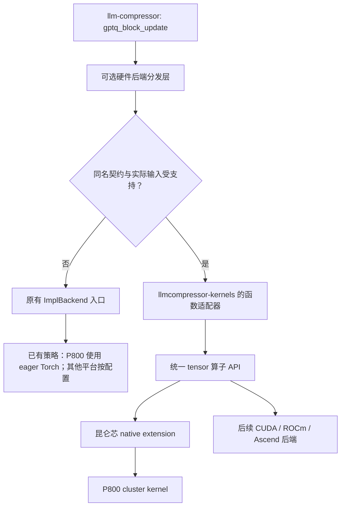

# llmcompressor-kernels 架构与首个算子迁移方案

状态：架构方向已获用户认可，首版实现与 P800 验证完成。日期：2026-11-04。

前文保留评审时的实施方案，首版交付和验证结果见第 10 节，
未安装插件时的兼容性验证见第 11 节。

评审补充：P800 必须保留现有 `ENFORCE_EAGER` 保护和禁用 Triton 的默认行为；
新库只通过独立入口调用预编译 native kernel，不触发运行时 JIT。
图编译本身不作为禁止条件；保留已有调用行为，不新增对 `torch.compile` 的全局或局部禁用。

## 1. 命名与定位

推荐名称：

| 对象 | 名称 |
| --- | --- |
| Git 仓库 | `llmcompressor-kernels` |
| Python distribution | `llmcompressor-kernels` |
| Python import | `llmcompressor_kernels` |
| Torch operator namespace | `llmcompressor_kernels` |
| 首版版本 | `0.1.0` |

名称直接表达用途，既包含量化算子，也能容纳 Hessian、observer、剪枝等后续算子，
不绑定昆仑芯或某一种算法。这里确定工程命名；公开发布前还需核验包名和目标组织下的仓库名。

备选为 `llmcompressor-ops`，更强调算子接口；推荐使用 `llmcompressor-kernels`。

工程目标：

- 一个独立源码仓维护统一 Python API、注册协议和多个硬件后端。
- 各后端独立选择工具链、SDK、编译参数和构建产物。
- llm-compressor 自动发现已安装插件，按同名算子、契约版本和实际输入选择实现。
- 缺少插件、缺少对应算子或输入不受支持时，继续使用 llm-compressor 现有实现。
- 首版交付昆仑芯 P800 上的 `gptq_block_update`，为其他平台保留扩展接口。

首版不承诺 CUDA、ROCm、Ascend 的硬件实现或性能；这些平台后续分别实现并验收。

## 2. 当前代码审查结果

### 2.1 llm-compressor 已有分发入口

本地 `src/llmcompressor/modifiers/gptq/gptq_quantize.py` 中：

- `gptq_block_update` 使用 `@ImplBackend.entrypoint("gptq_block_update")`。
- 同一文件注册了 Triton 实现，优先级为 `0`。
- eager 函数原地修改 `W1`、`Q1`、`Err1`、`losses1`，返回 `None`。
- `column_scale_window` 负责量化策略、分组索引、全局 scale 和块起始列的转换。

依赖中的 `ImplBackend` 根据实际输入执行 requirement，优先尝试较小的 priority。
其 eager 函数可通过装饰器保留的原始函数入口获取，用于隔离注册后端的测试。
实施时必须在 node16 上核验实际安装依赖的接口，不能只依赖本地缓存源码。

### 2.2 禁用 Triton 与禁用全部后端存在耦合

`src/llmcompressor/_triton_env.py` 在默认禁用 Triton 时设置
`CT_ENFORCE_EAGER=1`，并可能设置 `impl_backend.ENFORCE_EAGER`。
`ImplBackend.entrypoint` 在该开关开启时会跳过所有已注册后端。

因此，单纯把新 kernel 注册到现有 `ImplBackend`，在当前默认配置下可能完全不会调用。
实施必须保留这个开关及其原有保护效果，通过独立分发桥增加预编译 native kernel 路径。
不能通过清除 `ENFORCE_EAGER`、启用 Triton 或增加运行时 JIT 使 P800 kernel 可调用。

已核验本地 Git 提交：

| 提交 | 日期 | 已有保护 |
| --- | --- | --- |
| `0926d3929` | 2026-10-10 | 非 Triton 平台的 GLM-5-next KDA 选择及 Torch fallback |
| `924b570f6` | 2026-10-13 | GPTQ/MSE requirement 检查全局 Triton 开关，统一模型级后端选择 |
| `3a2b79568` | 2026-10-22 | 导入依赖前设置 `CT_ENFORCE_EAGER`，更新已加载注册器，并增加导入顺序回归测试 |

这些已提交的实现及开关语义保持不变，运行其已有测试以验证兼容性。
当前 `ImplBackend.ENFORCE_EAGER` 控制注册后端选择，本身不是通用 JIT 拦截器；
不因本次接入而扩展为禁止所有图编译的全局策略。避免 Triton/JIT 的既有路径继续生效，
新插件额外保证安装时编译、运行时只加载预编译二进制，不使用动态编译后端。

### 2.3 首个 kernel 的实际来源

本次通过长期容器 shell 只读核验：

| 项目 | 值 |
| --- | --- |
| 主机 | `node16` |
| 容器 | `zhuang_xsgl_1020` |
| 源仓库 | `/data/xflashinfer` |
| 源仓库 HEAD | `33a385384d21c7ca9b135736aa6f9f6f78f19b58` |
| Python 环境 | `python310_torch29_cuda` |
| Torch 自报版本 | `2.9.0+cu129` |

待迁移文件仍是源仓库中的未提交改动；HEAD 本身不包含这次 kernel。
本地 `/Users/ang/Projects/xtorch_ops` 中没有本次 `gptq_block_update` 实现，
不能把该本地目录当作迁移源。

源文件：

```text
csrc/infer_ops/src/kernel/kunlun3cpp/quant/gptq_block_update.xpu
csrc/infer_ops/src/wrapper/quant/gptq_block_update.cpp
csrc/infer_ops/include/infer_ops.h
csrc/infer_ops/tests/unittest/refactor/quant/test_gptq_block_update.cpp
csrc/infer_ops/tests/benchmark_gptq_block_update.py
```

迁移时另存源文件 SHA256、相关 diff、头文件依赖和编译配置，保留源仓库原文件及无关改动。

### 2.4 旧结果的适用范围

此前记录的主形状为 `batch=2, rows=4096, width=128`：

| 测量对象 | 历史中位耗时 |
| --- | ---: |
| Torch `gptq_block_update` | 65.139 ms |
| cluster C++/kernel 路径 | 0.336 ms |

两者相除约为 `193.9x`。这是历史不同测量层次的结果，不能作为新 Python 插件入口的最终加速比。
旧 benchmark 中 Torch 侧包含完整函数工作，custom 侧通过 C++ 测试二进制获取计时，
而且性能模式跳过 correctness check。

已核验的旧 C++ 单测比较自写 CPU 参考和 XPU 输出，并使用 `allclose`；
不能据此声称与真实 Torch 函数的所有输出逐位相同。

## 3. 架构决策

### 3.1 三层职责



第一层是 llm-compressor 的集成桥，负责发现插件、匹配算子和决定 fallback。
第二层是新仓的 Python API 与函数适配器，负责量化参数准备和完整函数语义。
第三层是按平台构建的 native extension 与设备 kernel。

新仓的底层 tensor API 不依赖 llm-compressor，只有函数适配器依赖已验证版本的
llm-compressor 与 compressed-tensors。新库可以单独进行底层编译和测试。

### 3.2 外部后端使用独立分发桥

推荐在 llm-compressor 的原函数外层增加一个通用可选后端装饰器：

```python
@optional_hardware_backend("gptq_block_update", contract_version=1)
@ImplBackend.entrypoint("gptq_block_update")
def gptq_block_update(...):
    ...
```

该示例表示装饰顺序，省略号不是最终函数签名。

外层先按执行策略筛选外部实现，未命中再进入原 `ImplBackend`。
在 P800 上只允许外部预编译 native 实现，未命中进入已受 `ENFORCE_EAGER` 保护的 Torch fallback。
不修改 compressed-tensors 私有注册表，不 monkey-patch 已导入的函数，
不在运行时改写全局 eager 开关。其他平台仍按原有配置选择内部 Triton/eager 路径。

P800 上保留 `ENFORCE_EAGER` 与增加 native kernel 路径可以同时成立：
Python 入口调用已构建的设备二进制，不引入运行时 JIT 或 Triton 执行。
不产生运行时 JIT 的图捕获或图执行不因本次接入而受限。

实施方案比较：

| 方案 | 结论 |
| --- | --- |
| 清除 `ENFORCE_EAGER` 后向现有 `ImplBackend` 注册 | 不采用，可能重新开放受禁用保护的路径 |
| 修改 compressed-tensors，使其区分 Triton 和 native 后端 | 可作为未来上游改造，首版不增加该依赖 |
| 保留现有保护，在外层独立分发预编译 native kernel | 推荐，保护策略和插件扩展的职责明确 |

这意味着需要对 llm-compressor 做一次小规模集成修改；只安装一个 wheel，
无法让尚未具备插件发现入口的旧版 llm-compressor 自动接管调用。

建议集成改动范围：

```text
src/llmcompressor/utils/hardware_ops.py
src/llmcompressor/modifiers/gptq/gptq_quantize.py
tests/llmcompressor/utils/test_hardware_ops.py
tests/llmcompressor/modifiers/gptq/test_hardware_backend.py
```

新增算子只需要在对应函数声明同名入口，不应再编写一套平台判断。

### 3.3 自动发现协议

使用 Python distribution entry point，group 为 `llmcompressor.ops`。
新仓在包元数据中声明：

```toml
[project.entry-points."llmcompressor.ops"]
llmcompressor_kernels = "llmcompressor_kernels.integration.llmcompressor:get_provider"
```

加载时机是第一次调用可加速函数，避免顶层导入就初始化硬件运行时。
发现结果在进程内缓存，初始化加锁；不缓存仅由某个 device 恰好空闲或可用得出的结论。
安装插件后需启动新进程，不要求运行中的进程发现新装的包。

provider 返回带版本的算子描述。逻辑结构：

```text
Provider
  protocol_version = 1
  name = "llmcompressor_kernels"
  operators:
    name = "gptq_block_update"
    contract_version = 1
    backend = "kunlunxin"
    implementation = "cluster"
    execution_kind = "precompiled_native"
    priority = 0
    supports = 可调用对象
    invoke = 可调用对象
```

协议约定：

- 匹配键是“算子名 + 契约版本”；仅名字相同不足以认为接口兼容。
- `supports` 接收与原函数相同的参数，只检查元数据和已缓存能力，不写 tensor、不启动 kernel。
- 具体 backend 的可用性还需检查 SDK/runtime、设备架构和扩展构建信息。
- `execution_kind` 声明执行方式；首版仅接受 `precompiled_native`，
  不注册 Triton、TorchInductor 或运行时 JIT 实现。不能只根据 backend 名字判断安全路径。
- `invoke` 接口保持原函数签名与返回值，包括 keyword-only 参数。
- priority 越小越先尝试；同名、同平台、同契约的相同 priority 冲突需要明确报错。
- provider 注册必须幂等，不通过任意 `getattr(torch.ops, name)` 判断算子是否可用。
- loader 不持有与某次输入绑定的 tensor，不复用跨设备的临时 buffer。

新仓通过同一份算子描述提供 `list_ops()`、`is_available()` 和 `explain()`。
这些诊断接口不进行 benchmark，也不执行设备计算。

### 3.4 选择开关与失败处理

拟提供 `LLMCOMPRESSOR_OPS_BACKEND`：

| 值 | 行为 |
| --- | --- |
| `auto`，默认 | 外部实现满足条件则调用，否则进入已有入口 |
| `native` | 跳过外部插件，进入已有 Triton/eager 分发 |
| `torch` | 只执行该函数原始 eager Torch body，用于排查和基准 |
| `kunlunxin` | 强制此平台实现；缺包、缺算子或不支持输入时明确报错 |

`LLMCOMPRESSOR_DISABLE_TRITON` 和 `CT_ENFORCE_EAGER` 的设置与已有保护逻辑原样保留。
外部 `precompiled_native` 实现通过独立桥调用，不需要解除内部保护。
需要排除预编译 native kernel、强制纯 Torch 函数作为参考时使用上述 `torch` 模式。

后端选择不能改变执行策略：指定 `kunlunxin` 不得清除 eager 标志，
`native` 只跳过插件，不得强制启用内部 Triton。

P800 执行策略矩阵：

| 路径 | 是否允许 |
| --- | --- |
| Python eager 调用已安装的 P800 cluster 二进制 | 允许 |
| Python eager 调用 Torch 原生算子作为 fallback | 允许 |
| Triton 实现，包括第三方插件转调的 Triton | 禁止 |
| 产生运行时 JIT 的编译后端 | 禁止 |
| 不产生运行时 JIT 的图编译/执行 | 保持原有行为，不增加限制 |
| 安装或开发构建阶段用 XTDK 编译 `.xpu` | 允许 |
| 导入或首次调用时运行 JIT 编译 | 禁止 |

不增加 `torch.compiler.disable`，不 monkey-patch `torch.compile`，
不改变现有图捕获和执行策略。适配器、helper 和 native extension
不主动转调 Triton 或运行时构建 API。通过已有回归测试及新增执行探针验证，
不为本次算子迁移重写整个进程的执行策略。

在 `auto` 模式下：

- 插件未安装、未声明该算子、协议不兼容、SDK 缺失或输入不支持：进入原实现。
- 已安装插件加载失败：记录一次包含真实原因的警告，再进入原实现。
- `supports` 意外抛出程序错误：抛错，不能把实现 bug 伪装为“不支持”。
- `invoke` 或已启动的 kernel 失败：向上传播，禁止自动 fallback。

最后一条是原地更新算子的必要约束：不能对已经部分修改的输入再执行 Torch。
异步设备错误在后续同步点出现时，也不能自动重跑。

## 4. 仓库结构与平台构建

建议本地独立仓库位于 `/Users/ang/Projects/llmcompressor-kernels`，
node16 上位于 `/data/llmcompressor-kernels`。

```text
llmcompressor-kernels/
├── pyproject.toml
├── CMakeLists.txt
├── README.md
├── src/llmcompressor_kernels/
│   ├── __init__.py
│   ├── registry.py
│   ├── diagnostics.py
│   ├── ops/gptq.py
│   ├── integration/llmcompressor.py
│   └── backends/kunlunxin/
├── csrc/
│   ├── common/
│   └── kunlunxin/
│       ├── bindings/
│       ├── host/
│       ├── kernels/gptq_block_update.xpu
│       └── include/
├── cmake/backends/
│   └── Kunlunxin.cmake
├── tests/
│   ├── unit/
│   ├── integration/
│   └── hardware/kunlunxin/
├── benchmarks/gptq_block_update.py
└── docs/
    ├── architecture.md
    ├── backend-development.md
    ├── build-kunlunxin.md
    ├── llmcompressor-integration.md
    ├── operators/gptq_block_update.md
    └── validation/
```

平台名称使用 `kunlunxin`，避免和其他厂商的 `xpu` 混淆。
CUDA/ROCm/Ascend 实现加入时分别新增对应目录与构建模块，不创建无实现的注册项。

构建方案是 PEP 517 Python 打包入口、setuptools 构建扩展与 CMake 平台目标。
昆仑芯设备对象编译由独立 CMake 模块调用 XTDK 工具链。
构建选项 `LLMCOMPRESSOR_KERNELS_BACKEND` 取 `none`、`kunlunxin` 或后续平台名：

- 默认 `none` 构建纯 Python 控制层，安装机器不需要厂商 SDK。
- 显式 `kunlunxin` 时检查 XTDK、runtime、Torch 及桥接头文件/库，缺失即构建失败。
- 首版每个 native wheel 只包含一个平台，构建日志明确列出平台、架构和版本。
- 开发环境使用已安装的厂商 Torch，通过 `--no-build-isolation` 构建；
  避免隔离构建环境下载并替换成另一套 Torch。
- 安装或导入已构建 wheel 不执行 JIT 编译，不要求用户另行运行 `torch.compile`。
- 单独导入 Python 包不加载所有平台 `.so`，按需求延迟加载目标扩展。
- native wheel 包含 build manifest，记录 Torch/ABI、Python、SDK、目标芯片及源码摘要。
- 不把厂商 SDK 全量复制进仓库或 wheel；部署依赖和动态库搜索路径需要写入平台文档。

首版独立编译实际用到的设备文件、launch wrapper 和最小头文件。
不能通过链接旧 `libapiinfer.so`、导入 `xflashinfer` 或引用旧仓库绝对路径实现“迁移”。
若某个 context/stream 桥接能力只能由单独的厂商开发包提供，明确记录为依赖，
不隐藏为对旧源码仓的依赖。

未来需要同进程安装多个厂商 wheel 时，可拆为核心包和独立 provider distributions；
首版先保证一个源码仓、独立平台构建目标和稳定插件协议。

## 5. Python API 与原地语义

### 5.1 函数适配层

对 llm-compressor 注册的算子名为 `gptq_block_update`，完整签名保持：

```python
def gptq_block_update(
    W1, Hinv1, Q1, Err1, losses1, *,
    scale, zero_point, global_scale, g_idx, quant_args, i1,
) -> None:
    ...
```

适配器调用现有 `column_scale_window` 得到实际逐元素 scale/zero-point，
再调用新库的底层 tensor API，最后填充 `losses1 = Err1.square()`。
首版允许最后一步是一个 Torch 算子，其耗时必须计入完整函数基准。
是否将 losses 写回融合到 kernel，依据迁移后 profiling 决定。

集成模块只在需要时导入 llm-compressor helper，不在包顶层反向导入量化入口，
避免循环导入。函数契约版本和依赖版本范围必须同时检查。

### 5.2 底层 tensor API

```python
llmcompressor_kernels.ops.gptq_block_update(
    work, hinv, scale, zero_point, quantized, errors, *,
    q_min=-8, q_max=7,
) -> None
```

底层只接受 tensor 和简单数值，不接受 `QuantizationArgs`。
对应 Torch schema 需声明 `work`、`quantized`、`errors` 的独立可变 alias，
不能注册为无副作用的纯函数。具体 dispatch key 在厂商 Torch 上验证后确定。

执行必须使用输入 tensor 对应设备和调用者当前 stream，不使用私有默认 stream，
不在生产调用路径加入全卡同步。多设备选择需要 device guard，并验证临时 tensor 生命周期。

### 5.3 首版能力边界

| 条件 | 首版策略 |
| --- | --- |
| 设备 | 已识别的 Kunlunxin P800，不能仅检查 `device.type == "cuda"` |
| `W1/Hinv1/Q1/Err1/losses1` | FP32、3D、同设备、输出与工作区不重叠 |
| block width | 64、128；其余走原实现 |
| 量化类型 | signed INT4，范围 `[-8, 7]` |
| scale | 首版接受 FP32，其他 dtype 先 fallback，避免改变反量化舍入语义 |
| zero-point | `None` 或受支持的非对称 FP32 参数 |
| qparam 策略 | 通过现有 helper 转换；逐项通过集成测试后才声明支持 |
| 非连续 `Hinv1` | 显式支持步长或在适配器中 contiguous；复制计入耗时 |
| 非连续可变输出 | 首版 fallback，避免悄悄写入副本 |
| 空 batch/rows、autograd、未知 layout | 首版不接管，保留原函数行为 |

`Hinv1` 来自大 Hessian 的子块切片，真实调用中可能不连续。
不能只测试独立构造的连续 `[B,K,K]`，否则会漏掉主流程开销和正确性风险。
量化参数准备可能分配临时 tensor；`supports` 必须在这些操作前完成选择。

### 5.4 必须核验的数值语义

迁移前源仓 cluster 实现逐列写 `work[column] = quantized_value`，
并对后续列执行 FMA；eager 对包括对角元素的尾部执行乘法与减法。
两者在实数公式上相关，但浮点执行顺序和 `W1` 最终值可能不同。

迁移验收必须分别检查：

1. `Q1` 的量化码是否与真实函数一致，特别是半整数边界、饱和边界和非零 zero-point。
2. `W1` 是否满足原函数的实际更新语义，不能仅因为最终块会被覆盖就忽略差异。
3. `Err1`、`losses1` 是否符合定义，返回值是否仍为 `None`。
4. scale 截断、舍入次序、除法精度、FMA 与 eager 分步算术的区别。
5. 输入 `Hinv1`、scale、zero-point 是否保持不变。

旧“精确 cluster”描述仅表示相对此前参考的实现路径，不能替代函数级验证。
数值问题必须修复或缩小可接管条件；不能单纯放宽容差掩盖量化码翻转。

## 6. 首个算子的迁移步骤

### 阶段 A：冻结来源并建立独立构建

- 保存 node16 源文件、SHA256、diff、工具链配置与依赖清单。
- 建立新仓目录、Python 包、平台注册描述及最小 native build。
- 迁移 cluster 实现，去除与本算子无关的 infer_ops 模板、dump 和测试基础设施。
- 原始 SDNN 文件作为来源记录保留在旧仓；首版新库不编译、不注册 SDNN。
- 在独立仓干净构建，确认链接与运行均不依赖旧 xflashinfer 产物。

SDNN 尚有数值翻转和设备模式恢复方面的未解决风险；本次交付不需要运行它。

### 阶段 B：补齐 Python 与 llm-compressor 集成

- 完成 tensor binding、设备/stream 适配和参数验证。
- 完成与原函数同签名的集成适配器。
- llm-compressor 增加通用插件加载器及函数外层分发。
- 添加自动选择、强制 Torch、未安装插件和不支持输入的测试。
- 保留 `ENFORCE_EAGER` 和默认禁用 Triton 的行为，确认仍能选择符合条件的预编译 P800 后端。
- 验证插件无 Triton、运行时编译后端或首次调用 JIT 路径，不新增图编译禁用逻辑。

### 阶段 C：正确性与主流程验证

所有对照使用同一组初始输入的独立 clone，分别调用真正的 eager body 和插件入口。
测试中显式绕过 Triton/插件，避免把加速函数误当作 Torch reference。

验证矩阵至少覆盖：

- `B=1,2,3,16`，rows 包含小值、非对齐值、4096 和 16384，width 64/128。
- 对称/非对称 INT4、零和非零 zero-point，以及实际有效的 global-scale 配置。
- tensor/channel/group/tensor-group/block 策略，非零 `i1` 和跨 group 的块。
- 非连续 Hessian 子块、受支持的输出布局及不支持时的 fallback。
- 多个固定随机 seed、舍入边界、饱和值和适用范围内的极小正 scale。
- `Q1/W1/Err1/losses1` 全量比较和只读输入保持性。
- 非默认 stream、同设备连续调用以及设备切换。
- `_quantize_weight_batched` 的完整量化流程，包括块间误差传播和最终权重。
- `ENFORCE_EAGER` 开启时 native 命中、插件缺失、输入不支持三条路径；
  内部 Triton 与 runtime JIT 的测试探针均应保持未触发。
- 原有 Triton 开关及导入顺序回归测试；不引入额外的图编译开关或行为修改。

测试报告同时给出量化码 mismatch 数、绝对误差和相对误差。
容差须在运行前依据 FP32 算术语义确定并记录，失败时先分析差异。

### 阶段 D：性能复测

主基准必须通过真实函数 `gptq_block_update` 的两种分发模式测试：

| 测量 | 计时范围 | 用途 |
| --- | --- | --- |
| eager 完整函数 | 原始函数 body 的全部工作 | 主基线 |
| 插件完整函数 | 发现缓存后分发、qparam 准备、必要拷贝、kernel、losses | 主加速比 |
| 底层 kernel | 已准备好参数后的设备执行 | 定位瓶颈 |
| 完整 GPTQ 量化 | 包括分块与块间传播 | 主流程收益 |

不使用 `torch.compile` 构造主基线。native extension 在安装时编译，
与 Torch eager 函数是否编译是两个独立概念。

每轮重置输入与输出，准备和 reset 在函数计时外完成，但函数自身所需的准备工作计入时间。
相同输入、形状、量化配置、卡与同步方法用于两侧。
热身至少 5 次，正式采样至少 30 次，保留全部样本并报告 p50、p90 和波动。
冷启动的扩展加载与首次发现单独报告，不混入稳态结果。

完整函数主结果采用主机计时并在边界同步。
设备事件仅在该平台确认计时可靠后用于 kernel 细分。
最终倍数定义为：

```text
函数加速比 = eager 完整函数 p50 / 插件完整函数 p50
```

初始回归目标是检查主形状底层 kernel 是否较旧 `0.336 ms` 明显退化；
大于 10% 的差异需要解释卡状态、工具链、数值修复或计时口径。
完整函数不预设必须达到 `193.9x`，以新增 Python 入口的实测为准。

## 7. node16 执行约束

- 保持一个长期容器 shell，连续完成构建、验证和日志采集。
- 使用既有容器和环境，不重装或替换当前厂商 Torch。
- 每轮设备测试前检查物理卡进程、显存和利用率，不只检查有没有进程。
- 无进程但持续高利用率的卡不视为空闲，不复用此前异常的卡。
- 选择空闲物理卡后，在启动 Python 前设置设备可见性，记录物理编号与逻辑编号映射。
- 只有 metadata/源码审查不占卡；编译完成后再选择设备开始测试。
- 不自动 reset 卡、不终止他人任务、不运行遗留 SDNN 路径。
- 测试超时只清理本次启动的进程，保留诊断和日志。

报告写入新仓 `docs/validation/`，记录源码版本/dirty 摘要、wheel 摘要、完整命令、
SDK/Torch/驱动、卡型号/编号、正确性配置和完整计时样本。

## 8. 文档与交付验收

新仓首版需具备：

- `README.md`：安装、最小 Python 调用、llm-compressor 自动接管、禁用与诊断。
- `docs/architecture.md`：协议、分发顺序、错误处理、平台边界。
- `docs/backend-development.md`：新增平台/算子的注册、构建和测试要求。
- `docs/build-kunlunxin.md`：SDK、工具链、Torch ABI、构建命令与动态库依赖。
- `docs/llmcompressor-integration.md`：兼容版本、开关、fallback 及运行选择的观察方式。
- `docs/operators/gptq_block_update.md`：签名、shape/dtype/stride、原地更新、数值要求。
- `docs/validation/`：独立构建、函数级正确性和性能报告。

首版完成条件：

1. 新仓可独立构建并生成可安装 wheel，运行不依赖旧源码仓及其算子库。
2. 不安装插件时 llm-compressor 保持现有可用行为。
3. 安装插件后，符合条件的同名函数自动走 P800 cluster 实现，且有诊断证据。
4. 不支持输入正常回退，强制选择时准确报错，kernel 出错后不重跑脏输入。
5. 完成真实函数全部输出、完整量化流程、默认禁用 Triton和非默认 stream 测试。
6. 给出真实 `gptq_block_update` eager 对插件完整函数的实测倍数与原始数据。
7. 保留现有 `ENFORCE_EAGER` 保护；P800 路径只执行 eager Torch 或预编译 native kernel，
   不触发 Triton 或运行时 JIT，不改变不产生 JIT 的图编译行为。

## 9. 已认可的实施方向

用户已认可的架构方向及后续实施约束：

1. 仓库命名为 `llmcompressor-kernels`，Python 包为 `llmcompressor_kernels`。
2. 独立插件协议通过 `llmcompressor.ops` 自动发现，llm-compressor 外层桥接，
   原 `ImplBackend` 及 `ENFORCE_EAGER` 保护保留；P800 外部实现仅允许预编译 native kernel。
3. 一个源码仓、按平台编译，首版交付 Kunlunxin P800 cluster 实现和 Python 入口。
4. 首版不引入 SDNN，主验收是函数语义、独立构建、自动接管和完整函数性能。
5. 按本文建议位置建立本地和 node16 独立仓库，完成验证后交付，暂不提交或推送 Git。

先完成既有提交与兼容性核查，再按以上方向实施；有事实依据需要改变架构时补充说明。

## 10. 首版实施结果

代码仓：`/Users/ang/Projects/llmcompressor-kernels`；
node16 目录：`/data/llmcompressor-kernels`。
交付 native wheel、纯 Python wheel、Python 入口、平台注册、
可复用的 llm-compressor 集成补丁和文档。

既有 `0926d3929`、`924b570f6`、`3a2b79568` 的保护逻辑保留，
不新增 `torch.compiler.disable` 或全局编译开关。最终回归测试 28 项通过。

大样本发现原 FMA 路径的一个量化码翻转；通过独立乘减、禁止 FP contraction、
分别保留 workspace 与量化输出修正，反例已加入回归。
最终两种 width 及大样本对照报告中，全部四类可写 tensor 的已检查元素逐一相同。

| 形状 B/R/K | Torch 函数 p50 | auto 插件函数 p50 | 加速比 |
| --- | ---: | ---: | ---: |
| 2 / 4096 / 128 | 63.342833 ms | 0.411673 ms | 153.87x |
| 2 / 4096 / 64 | 32.316037 ms | 0.233546 ms | 138.37x |

每种模式热身 5 次、正式测量 30 次，使用空闲 P800 物理卡 4。
函数计时包括参数准备、必要 Hessian 拷贝和 losses 写回。
完整命令、原始样本、来源摘要和适用范围见新仓 `docs/validation/README.md`。

## 11. 未安装插件时的兼容性

`llmcompressor-kernels` 不是本项目的必装依赖。默认 `auto` 模式下，
发现不到 `llmcompressor.ops` provider 时，外层分发直接调用原来的
`ImplBackend` 入口；不导入 kernel 包，不加载 native 扩展，也不改变原有
`CT_ENFORCE_EAGER` 和 Triton 开关。现有量化流程继续使用原来的后端策略。

集成回归包含真实的 `quantize_weight` 多块量化对照：
使用两个 batch、非对角正定 Hessian、分组 INT4、activation ordering、
对称和非对称量化，以及不足完整块宽的尾块。
没有 provider 时，默认 `auto`、`native`、`torch` 三种模式的量化权重、
loss 和 RTN 标志均要求与直接执行原始 eager 函数逐元素一致，并检查输入未被修改。
已有 GPTQ 测试及 Triton 开关和导入顺序回归也一并执行。

2026-11-04 在本地 CPU 环境确认 kernel distribution 未安装，
`llmcompressor.ops` entry point 和 `available_hardware_ops()` 均为空。
环境为 Python 3.12.10、Torch 2.12.1、compressed-tensors 0.17.2a20260806；
验证命令如下：

```bash
.venv/bin/python -m pytest -q \
  tests/llmcompressor/utils/test_hardware_ops.py \
  tests/llmcompressor/utils/test_triton_backend.py \
  tests/llmcompressor/modifiers/gptq/test_gptq_quantize.py
```

结果为 35 passed、44 skipped；跳过项需要 CUDA/GPU 或指定计算能力。
这次验证覆盖 CPU 量化和分发兼容性，不代表重新完成 P800 或大型模型验证。
P800 插件安装后的验证仍以第 10 节及独立仓库原始报告为准。

如果显式设置 `LLMCOMPRESSOR_OPS_BACKEND=kunlunxin`，表示要求使用该后端；
未安装插件或输入不受支持时会明确报错。需要插件可选时保留默认 `auto`。

本次提交仅包含 llm-compressor 集成桥、GPTQ 入口的两行接入、测试和本文档；
独立 kernel 仓库及 native wheel 不包含在本项目提交中。
