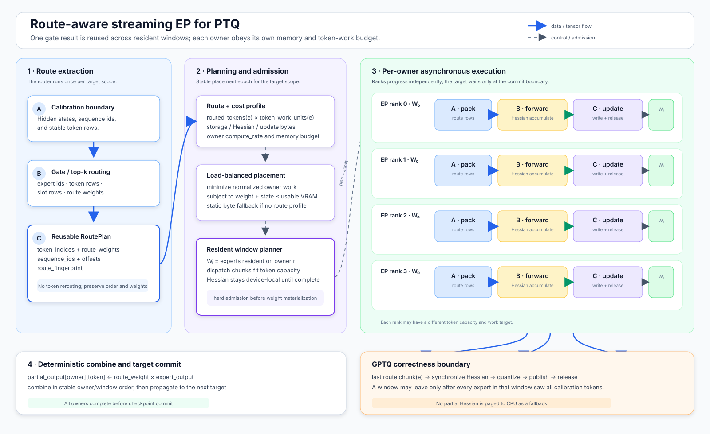
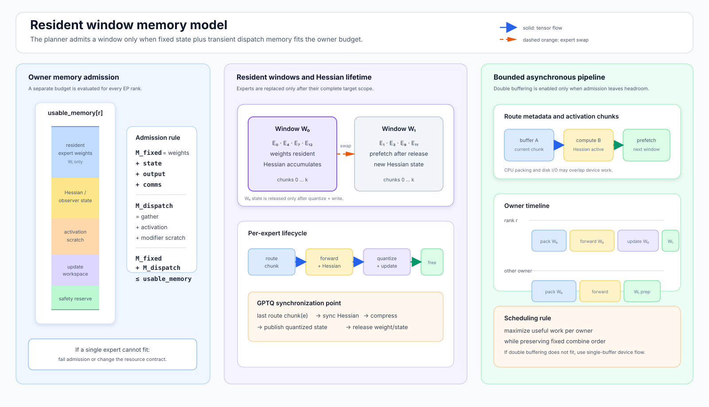

# Streaming EP 负载均衡设计

日期：2026-11-18。

状态：设计评审中。本文只整理问题、目标架构和实现顺序；在用户确认前不
启动新的端到端量化测试。

本文针对 streaming PTQ 的通用 Expert Parallelism（EP）负载均衡。设计不依赖
DSV4.1 的类名，也不要求模型类增加 `configure_streaming_ep`。DSV4.1、
GLM5、标准 `ModuleList`/`ModuleDict` MoE、fused/native MoE 通过外部
`StreamingMoEAdapter` 提供模型结构和路由信息，EP 核心只处理 placement、
资源约束、调度和统计。

## 1. 本轮要解决的问题

当前八卡低利用率有两个相互独立的来源：

1. **专家 owner 的放置只按权重字节数平衡。** routed token 的历史分布没有
   参与 placement。权重大小相同的专家通常被轮转到各 rank，但热门专家可能
   集中在少数 rank。
2. **token capacity 只是安全上限，不是负载均衡目标。** 它限制一次 dispatch
   能接收多少 token，不能把热门专家迁移到空闲 rank，也不能改变已有专家的
   owner。
3. **输入 microbatch 只由主设备 capacity 决定。** 其他 rank 即使有更大
   capacity，也不会反过来扩大输入窗口。
4. **modifier update 仍由一个 pipeline 调用串行推进。** EP forward 可以让
   多个 owner 同时执行，但 GPTQ 的每个模块压缩通常仍在一个控制线程中按
   模块顺序调用，导致某个 owner 工作时其他 owner 等待。

因此，“把每个 rank 的 token 数设置成相同值”不是完整方案。需要同时解决：

- 专家应该放在哪个 owner；
- 每个输入窗口会给各 owner 带来多少工作；
- 不同 owner 的显存容量和实际吞吐可能不同；
- modifier 的 update 是否可以按 owner 并行；
- 运行时路由发生偏移时如何保持正确性。

## 2. 当前实现的准确语义

### 2.1 专家放置

`src/llmcompressor/streaming/parallel/expert.py` 中的
`_balanced_expert_owners()` 先按专家模块的参数和 buffer 字节数降序排列，
然后把每个专家放入当前累计字节数最小的 owner：

```text
owner(e) = argmin_r current_weight_bytes[r]
current_weight_bytes[owner(e)] += weight_bytes[e]
```

它的输入只有：

- expert logical name；
- expert materialized bytes；
- owner 数量。

它不读取 calibration boundary，不读取 router 结果，也不读取历史
`dispatch_statistics`。因此当前 placement 是稳定的静态权重平衡。

这套策略对以下场景是合理的基础：

- 不同专家形状不同，需要先避免显存集中；
- 没有可靠路由预测；
- 需要在加载权重前确定 owner；
- 需要恢复时复用完全相同的 placement fingerprint。

它不能保证计算负载均衡。特别是 DSV4.1 的 384 个 routed experts 形状接近，
权重字节数几乎相同，placement 接近轮转；如果 calibration 的 routed token
分布长尾，计算负载会随专家 owner 聚集。

### 2.2 token capacity

`src/llmcompressor/streaming/pipeline.py` 在每个 target group 的权重加载前，
对每个 owner 计算：

```text
required_bytes[r, T] =
    materialized_owner_weights[r]
  + modifier_memory[r, T]
  + runtime_bytes_per_token[r] * T
```

然后在设备安全预留后的可用显存范围内二分搜索最大的 `T`。这里的 `T` 是
一次 dispatch 的 token 上限，不是专家 placement 的目标负载。

当前还会将不同阶段的容量取最小值，覆盖 calibration、modifier update 和
activation propagation 中实际启用的阶段。这个设计解决的是 OOM admission，
不解决热点 owner：

```text
capacity[r] = max safe dispatch tokens on owner r
```

它没有表达：

```text
desired_compute_work[r] = desired share of total routed work
```

两个概念必须继续分开。容量较大的 rank 可以承担更多工作，但不能据此把它
的专家权重放在热点 rank 上，也不能把其他 rank 的 expert call 直接迁移过去。

### 2.3 当前 dispatch

`ExpertParallelExecutor.forward_many()` 先执行 FX 图中已经 ready 的节点。
当它遇到 expert call 时，按 `plan.device_for(name)` 放入对应 owner 的队列。
`_group_ready_experts()` 按实际 expert 输入的 token 数累计：

```text
entry_tokens = prod(expert_input.shape[:-1])
```

加入下一个 call 会超过该 owner 的 `token_capacity` 时，当前 owner 的 group
结束。兼容的 expert call 可以拼接成一个 owner batch，执行后再按原始长度拆回。

因此当前 runtime 已经具备三个正确性保证：

1. 使用真实 routed tensor 的 token 数，而不是样本数或 padding 后的固定长度；
2. 每个 owner 可以有不同的 capacity；
3. 不改变 expert call 的原始顺序、route weight、`index_add_` 汇合和下游
   FX 依赖。

当前 runtime 没有做以下事情：

- 根据 token 历史重新分配 expert owner；
- 把一个 expert call 拆到多个 owner；
- 把 token 从一个 owner 转移到另一个 owner；
- 根据某个 owner 的空闲状态复制专家；
- 用 `dispatch_statistics` 反向修改 placement 或输入窗口。

`dispatch_statistics` 目前只用于日志和验收，不能被理解为已经存在动态
负载均衡。

### 2.4 当前输入 microbatch

`src/llmcompressor/streaming/parallel/expert.py` 的
`input_token_capacity` 只返回 `devices[0]` 的 capacity。
`src/llmcompressor/streaming/pipeline.py` 的
`_iter_execution_batches()` 再用这个值把 boundary 输入组合成
`forward_many()` 的窗口。

这保证了主设备的 boundary residency 不会越界，但有两个性能问题：

- 主设备 capacity 偏小会限制所有 owner 的输入窗口；
- 非主设备的 capacity 和路由工作量没有参与窗口规划。

这个限制不能简单改成所有 owner capacity 的最大值，否则主设备 boundary、
主卡 transfer scratch 和 output accumulation 可能 OOM。

### 2.5 当前 modifier update

target group 的生命周期仍是：

```text
load -> calibration -> modifier update -> propagation -> write -> unload
```

`_modifier_update()` 由 pipeline 统一调用。即使 resident modules 已分布在
多个 owner，modifier update 也不自动变成多 owner 并行。是否能并行必须由
modifier adapter 声明，因为不同 modifier 可能有：

- owner-local 的独立统计和 qparams；
- 跨模块共享的搜索状态；
- 必须保持模块顺序的更新；
- 需要跨 owner reduction 的状态；
- 不能被拆分的优化器或 provider workspace。

EP core 不能通过判断 `GPTQModifier` 类名来假设所有 modifier 都可并行。

## 3. 设计边界和不变量

### 3.1 正确性优先

负载均衡只能改变 expert 的执行归属和 dispatch 分段，不能改变模型语义：

- 不修改 router 的专家选择；
- 不改变 route weight 和 top-k 顺序；
- 不改变同一序列的 token 顺序；
- 不重排有状态模型的 calibration sample；
- 不改变 `index_add_` 或其他 in-place combine 的累加顺序；
- 不把一个原始 expert call 任意切成会改变 hook/sample 语义的片段；
- 不因 load balancing 恢复已经淘汰的全量 CPU Hessian offload。

如果某个 expert 必须由一个 owner 持有才能保持 GPTQ Hessian、observer 或
modifier state 的一致性，就保持整 expert ownership。

### 3.2 资源边界

每个 owner 同时受两种约束：

```text
fixed_memory[r] + transient_memory[r, dispatch] <= usable_memory[r]
planned_compute_work[r] <= scheduling_target[r]
```

第一项是硬约束，违反时必须在加载 target 前拒绝。第二项是性能目标，运行时
允许因为实际路由偏移而调整 dispatch 分段，但不能突破第一项。

`pipeline batch_size`、`EP dispatch token capacity` 和 modifier 内部 batch
size 继续保持三个独立概念：

| 概念 | 控制对象 | 是否用于 placement |
| --- | --- | --- |
| pipeline `batch_size` | 原始 calibration 输入的样本/模型 batch 语义 | 否 |
| EP token capacity | 单次 owner dispatch 的显存安全上限 | 否，只有 admission |
| EP workload target | owner 计划承担的计算工作量 | 是 |
| modifier batch size | update/search 算法自身的压缩批次 | 由 modifier contract 决定 |

### 3.3 泛化边界

EP 核心只依赖外部 adapter 提供的能力：

- expert collection 和 logical expert id；
- expert module 的 state/weight ownership；
- expert shape 和可选的 per-token compute cost；
- 可选的 route profile；
- 可选的 native local execution；
- combine 顺序和 partial output 规则；
- modifier 生命周期和资源 contract。

核心不读取 DSV4.1 字段，不处理 MTP、CSA2、Engram 或某个模型的 router
正则表达式。DSV4.1 adapter 可以提供 route/profile wrapper，但 wrapper 只
实现模型差异，不改变通用 planner 的输入输出契约。

## 4. 统一负载模型

### 4.1 Expert cost profile

为每个 logical expert 建立可序列化的成本描述：

```text
ExpertCostProfile(e) = {
    storage_bytes,
    persistent_state_bytes,
    update_work_units,
    token_work_units,
    route_tokens_estimate,
    shape_fingerprint,
}
```

字段含义：

- `storage_bytes`：参数和 buffer 的 materialized 字节数；
- `persistent_state_bytes`：modifier 在整个 target 生命周期保留的 Hessian、
  observer 或其他状态；
- `update_work_units`：modifier update 的预计计算量；
- `token_work_units`：该 expert 每处理一个 token 的计算工作量；
- `route_tokens_estimate`：本轮 calibration 或当前 target scope 的预测 routed
  token 数；
- `shape_fingerprint`：输入/中间/输出 shape、dtype 和 kernel 路径的身份。

普通 Linear expert 可以由 module shape 推导 `token_work_units`。fused/native
expert 由 adapter 提供同等语义的估算。无法提供有界估算时，planner 必须
进入保守 fallback 或在 preflight 明确拒绝，不能把未知成本当作零。

### 4.2 Owner profile

为每个 owner 维护：

```text
OwnerProfile(r) = {
    usable_memory_bytes,
    fixed_memory_bytes,
    token_capacity,
    compute_rate,
    transfer_rate,
    update_rate,
}
```

`compute_rate` 和 `update_rate` 首次可以使用设备同构假设；在 warmup dispatch
后使用 CUDA/XPU event 测得的有效工作吞吐修正。`xpu-smi` 利用率只作为外部
观测，不能作为调度闭环的唯一输入。

### 4.3 计算工作量

原始 token 数只适合 expert shape 相同的模型。通用 planner 使用加权工作量：

```text
work(e, batch) =
    routed_tokens(e, batch) * token_work_units(e)

normalized_work(r, batch) =
    sum(work(e, batch) for owner(e) == r) / compute_rate(r)
```

对于 DSV4.1 同一 collection 中 shape 相同的 experts，
`token_work_units(e)` 可以统一，结果退化为 routed token 数平衡。对不同
形状的 MoE，不能用 raw token 数掩盖大 expert 的真实成本。

## 5. 两阶段 placement 方案

### 5.1 第一阶段：静态安全 placement

在没有 route profile 时，保留当前按 `storage_bytes` 的稳定 greedy placement，
但将每个 owner 的以下数据同时记录到 plan：

```text
owner_weight_bytes
owner_persistent_bytes
owner_token_capacity
owner_static_work_estimate
```

这保证现有模型、无路由 adapter 和恢复任务继续工作。它是性能 fallback，不
伪装成 activation-aware placement。

### 5.2 第二阶段：activation-aware placement

如果 adapter 能提供 route profile，则在 target scope 开始前得到：

```text
route_tokens_estimate[e]
```

profile 必须说明来源、样本 hash、路由模式、top-k、是否 all-experts，以及
profile 与实际执行的稳定性承诺。推荐按以下优先级获取：

1. **已有可信 profile**：同一 checkpoint、相同 calibration 输入和相同
   router 语义，直接复用；
2. **route-only profile**：adapter 只执行 router/route conversion，不运行
   expert body，生成每个 boundary 的 expert token histogram；
3. **bounded warmup profile**：先执行有限数量的实际 boundary，收集 route
   histogram，仅用于尚未开始的 target scope；
4. **uniform/conservative fallback**：没有 profile 时使用静态 placement，并
   在 manifest 中标记 `profile_mode=static`。

不能在一个 target 已经开始累积 Hessian 后，将它的 expert 迁移到另一 owner。
如果 profile 在运行中更新，只能用于尚未加载的 target scope，或者显式新建
新的 placement epoch。一个 epoch 内的 placement 必须保持稳定，便于：

- GPTQ Hessian 与 module owner 一一对应；
- checkpoint writer 记录唯一 owner；
- recovery 复用相同计划；
- 对比 EP=1 与 EP=N 时保持 target 语义可解释。

### 5.3 多目标 greedy placement

给定 `ep_size=R`，先按预计计算工作量降序排序：

```text
estimated_work(e) =
    route_tokens_estimate[e] * token_work_units[e]
```

对每个 expert，枚举满足硬约束的 owner，选择加入后最大负载最小的 owner：

```text
candidate_score(r, e) =
    max(
        normalized_work[r] + estimated_work(e) / compute_rate[r],
        max_load_of_other_owners
    )
```

同分时依次使用以下 tie-break：

1. 加入后 `storage_bytes` 更小的 owner；
2. 加入后 `persistent_state_bytes` 更小的 owner；
3. 当前 `normalized_work` 更小的 owner；
4. rank id 更小的 owner。

硬约束包括：

```text
owner_weight_bytes[r]
    + persistent_state_bytes[r]
    + reserved_update_workspace[r]
    <= usable_memory_bytes[r]
```

如果一个 expert 单独就无法放入任何 owner，planner 必须报告：

- expert name；
- storage/persistent/update 需求；
- 每个 owner 的可用显存；
- 是否是单 expert 热点；
- 是否存在允许复制或拆分的 adapter capability。

默认直接失败，不静默启用 CPU offload，也不把一个有状态 expert 拆到多个
owner。未来如需支持 replicated expert，必须另建 modifier state merge 和
checkpoint 语义，不能作为本设计的隐式 fallback。

### 5.4 placement fingerprint

新的 plan fingerprint 至少包含：

```text
{
  "placement_policy": "ep-load-v1",
  "static_weight_profile": ...,
  "route_profile_fingerprint": ...,
  "expert_cost_profile": ...,
  "owner_profiles": ...,
  "placement_entries": ...,
  "profile_mode": "static|route_only|warmup|reused",
}
```

恢复时必须检查 profile identity、target scope、capacity policy 和 owner
topology。当前显存变多不能使恢复任务静默采用另一 placement；如果需要新
placement，必须新建 run。

## 6. route-aware 输入窗口和 dispatch

### 6.1 现有实现的保留部分

当前 `_group_ready_experts()` 的实际 token 计数、原始 entry 顺序、兼容输入
拼接、输出拆分和单 owner active dispatch 都保留。这些是正确性基础。

新的 scheduler 不会在 router 之后把 token 改路由到另一个专家。它只决定：

- 哪些已经确定路由的 expert calls 组成一个 owner dispatch；
- 哪些 calibration boundary 组成一次 `forward_many`；
- owner 之间何时提交下一项工作。

### 6.2 owner demand vector

对于一个候选输入窗口 `B`，planner 维护：

```text
demand[B][r] =
    sum(
        routed_tokens(e, B) * token_work_units(e)
        for owner(e) == r
    )
```

同时保留 raw token 计数，用于显存 admission：

```text
raw_tokens[B][r] = sum(routed_tokens(e, B) for owner(e) == r)
```

候选窗口只有在以下条件都满足时才可加入：

```text
primary_boundary_memory(B) <= primary_budget
raw_tokens[B][r] <= token_capacity[r]       for every owner r
demand[B][r] <= target_work_window[r]      for every owner r
```

如果没有 per-batch route profile，第一版可以使用：

- 主设备 boundary capacity 作为正确性上限；
- owner capacity 作为实际 dispatch 上限；
- 运行时实际 routed token 统计作为后续 scope 的 profile。

这种 fallback 必须明确记录为 `window_policy=primary-capacity-fallback`，
不能称为已完成的 route-aware batching。

### 6.3 work target 不是 capacity

每个 owner 的目标工作量根据设备速率和当前可用窗口计算：

```text
target_work_window[r] =
    min(
        token_capacity[r] * average_token_work[r],
        compute_rate[r] * target_window_seconds
    )
```

这允许不同设备承担不同数量的 token。目标是让 normalized work 接近，而
不是让 raw token 数强行相同：

```text
normalized_work[r] ≈ normalized_work[s]
```

当设备同构且 expert shape 相同，这才退化为各 owner 的 routed token 接近。

### 6.4 变长和有状态模型

输入窗口只能在 adapter 声明允许的边界上切分：

- 变长样本按实际 token 计数；
- 单个 boundary 不能容纳时提前在 admission 失败；
- 有 KV/runtime state 的模型不能为了填满 owner 而重排样本；
- 如果模型允许 token-level packed execution，必须由 adapter 明确声明
  sequence identity、mask、position 和 state combine 规则。

默认策略仍然保持完整 sequence 传播，精度优先，不引入 decoder KV-cache
复用或 prompt replay 近似。

### 6.5 gate route plan 与 resident expert window

这个方案的核心不是在 `_group_ready_experts()` 中再做一次 token 计数，而是把
gate 的输出提升为一个可复用的 `RoutePlan`。对于当前 target scope，adapter
需要能提供：

```text
RoutePlan = {
    expert_id,
    token_indices,
    route_weights,
    sequence_ids,
    offsets,
    route_fingerprint,
}
```

其中：

- `token_indices` 是 flatten 后的真实 token 行号；
- `route_weights` 保留 gate 的原始权重和 dtype 语义；
- `sequence_ids` 用于恢复变长 sequence 和输出 reshape；
- `offsets` 允许按 expert/owner 进行稳定切片；
- `route_fingerprint` 绑定输入 boundary、router 状态、top-k 和 dtype。

只记录每个 expert 的 token 数不够。要在专家换入换出后重新计算输出，必须
保留 token 行号和 route weight；否则无法执行等价的 gather、expert forward、
weight 乘法和 `index_add_`。

RoutePlan 的生命周期限定在一个 target scope。gate 本身可以只执行一次，
随后多个 resident window 复用它。对于有多个 calibration boundary 的 target，
RoutePlan 可以按 boundary 分段写入 `BoundaryActivationStore` 或独立的紧凑
metadata 文件，不需要把所有层、所有样本的 route metadata 同时放在显存。



图中左侧的 RoutePlan 保留 token 行号和 route weight，中间的 planner 只在
通过显存准入后生成稳定的 resident placement epoch，右侧各 owner 独立推进
pack、forward/Hessian、quantize/write/release。底部的 GPTQ correctness
boundary 表示专家必须完成全部校准 token 后才能释放 Hessian 和权重。

resident window 的规则如下：

| 情况 | 执行方式 |
| --- | --- |
| 所有专家权重、Hessian 和当前 token scratch 都能容纳 | 一个 resident window，按 token capacity 切 activation chunks |
| 所有专家权重和 Hessian 能容纳，但 token scratch 不能容纳 | 专家保持常驻，按 route token 切最少 activation chunks |
| 所有专家不能同时容纳 | 将专家按 weighted route work 和固定内存分成多个 resident windows |
| 单个专家的全部 Hessian 状态不能容纳 | 不能依靠普通 paging 解决；必须降低 target scope、改变算法资源 contract，或在 admission 失败 |

对于 GPTQ，第三种情况必须按以下顺序执行：

```text
选择 resident window W
  -> 为 W 内专家遍历全部 calibration RoutePlan
  -> 每个专家可以分成多个 activation chunks
  -> Hessian 在 owner device 上跨 chunks 累积
  -> 专家收到全部 routed tokens 后立即 quantize
  -> 写出量化权重并释放该专家 Hessian/scratch
  -> 进入下一个 resident window
```

这样换出的是已经完成压缩的专家权重和临时状态，不是把未完成的 Hessian
转移到 CPU。它是受控的 expert paging，和淘汰的全量 CPU Hessian offload
不同。

### 6.6 resident window 的最少批次和总成本

对 owner `r` 的 resident window `W`，显存约束应写成：

```text
M_fixed[r, W] =
    resident_weight_bytes[r, W]
  + resident_modifier_state_bytes[r, W]
  + output_accumulation_bytes[r, W]
  + communication_workspace[r, W]

M_dispatch[r, W, T] =
    route_gather_bytes[r, W, T]
  + expert_activation_bytes[r, W, T]
  + modifier_batch_scratch[r, W, T]

M_fixed[r, W] + M_dispatch[r, W, T]
    <= usable_memory[r]
```

因此窗口的最小 activation batch 数不是简单的：

```text
ceil(total_tokens / token_capacity)
```

而是根据每个 expert 的 route segment、shape、dtype、Hessian/update scratch
和不能跨 sequence 的切分边界计算。对于 shape 相同、可任意按 token 分块的
普通 expert，才可以近似为：

```text
chunks(W) = ceil(
    max_expert_tokens_in_window / max_dispatch_tokens(W)
)
```

resident window 的数量则是另一个 bin-packing 问题。它应优先最小化：

```text
total_cost =
    sum(window_route_scan_time)
  + sum(window_expert_compute_time)
  + sum(window_update_time)
  + weight_swap_io_time
```

而不是只最小化 window 数。一个很大的热点 expert 可能需要多个 activation
chunks，但仍然只需要一次换入；把它和很多冷专家塞进同一个 window 可能减少
window 数，却增加该 rank 的 critical path。

## 7. gate-to-update 异步流水

### 7.1 三阶段流水

每个 owner 可以使用有界深度为 1 或 2 的流水：

```text
Stage A: route/gather/pack
    -> Stage B: expert forward + Hessian accumulation
    -> Stage C: quantize/update/write/release
```

同时，下一 resident window 可以执行：

```text
prefetch next weights -> materialize next window -> wait for memory event
```

推荐的第一版全局流程是：

```text
Gate route plan
  ├─ owner 0: window 0  A -> B -> C
  ├─ owner 1: window 0  A -> B -> C
  ├─ owner 2: window 0  A -> B -> C
  └─ ...
       while C(window 0) runs:
         prepare/pack window 1 on idle owners
       after an owner releases window 0:
         materialize window 1 on that owner
```

不同 owner 不需要因为某个 owner 的 window 较慢而停止所有计算。最终
target output、modifier reduction、propagation 和 checkpoint commit 才是
必须等待所有 owner 完成的边界。



第二张图把两个容易混淆的约束拆开：左侧是每个 owner 的显存 admission，
中间是 resident expert 与 Hessian 的生命周期，右侧是有界的 route
metadata/activation 双缓冲。双缓冲只有在 `M_fixed + M_dispatch` 仍满足
owner 显存预算时才启用，否则退化为单缓冲设备流水。

### 7.2 可以安全重叠的工作

以下重叠不改变 GPTQ 数学：

- 当前 owner device 执行 expert kernel 时，CPU/主设备准备下一组 route indices；
- 当前 window 计算时，异步读取下一个 window 的 checkpoint weight；
- 不同 owner 同时执行各自的 resident window；
- 一个 owner 对已完成专家执行 update 时，另一个 owner 执行自己的 expert forward；
- 已完成专家的 checkpoint 写出与其他 owner 的计算。

以下重叠必须由 resource/modifier contract 明确允许：

- 同一个 owner 上同时保留两个 resident window；
- 同一个 owner 上 update window `W` 与 forward window `W+1` 同时占用设备；
- 多个 stream 并行写入同一个 output accumulation buffer；
- 多个 owner 同时修改共享 qparams、共享 observer 或共享 provider state。

默认只启用显式 admission 能容纳的双缓冲。若双缓冲会挤占 GPTQ Hessian
或 update scratch，退化为单缓冲流水，仍保留 route metadata、CPU pack 和
磁盘 I/O 的异步化。

### 7.3 GPTQ 的同步点

GPTQ 的正确同步点是“专家完成全部校准 token”，而不是“某个 activation
chunk 完成”：

```text
last_route_chunk(e)
    -> synchronize e's Hessian accumulation
    -> compress e
    -> publish e's quantized state
    -> release e's Hessian and resident weight
```

只有完成这条链路后，专家才允许换出。这样可以让不同 owner 的专家以不同
速度推进，同时不需要把 partial Hessian 放到 CPU。

如果 modifier contract 声明 update 依赖整个 target group，resident window
只能负责 route/activation 分段，不能提前释放其统计状态；这类 modifier 必须
走 target-serial fallback，或者实现自己的跨 window state contract。不能因为
GPTQ 可以做 window update，就假设 HIGGS、QAD 或 AutoRound 也可以照搬。

### 7.4 output accumulation 的顺序

多个 window 会对相同 token 产生部分输出。为保持现有 EP=1 对照的数值稳定性，
建议每个 owner 先写入独立的 partial output buffer：

```text
partial_output[owner][token] += route_weight * expert_output
```

所有 window 完成后，再按固定 owner/window 顺序合并到 target output。对于允许
非确定性浮点累加的 adapter，可以使用 owner-local fused combine 或一次
collective reduction；GPTQ 精度验收默认保留确定的合并顺序。

### 7.5 异步流水的调度目标

placement 和 window planner 的目标应从“各 rank token 数相同”升级为：

```text
critical_path =
    max_r(
        sum(window_compute_time[r])
        + sum(window_update_time[r])
        + transfer_time[r]
    )
```

同时最小化：

```text
queue_idle_time
weight_swap_time
route_rescan_time
```

因此专家按 token 数均衡只是第一近似。最终应按
`routed_tokens * token_work_units / measured_rate` 均衡，并将 update、I/O 和
不可避免的窗口换入开销纳入 rank 的预计 critical path。

## 8. owner executor 的调度改造

### 8.1 Work item

将当前隐式 tuple entry 规范化为内部 `ExpertWorkItem`，包含：

```text
{
  input_index,
  fx_node,
  expert_name,
  owner,
  raw_tokens,
  weighted_work,
  compatibility_key,
  sequence_order,
}
```

`compatibility_key` 继续决定哪些输入可以拼接；`sequence_order` 用于恢复
原始 graph 的 mutation 和 combine 顺序。

### 8.2 owner-local queue

每个 owner 保留独立队列和独立 CUDA/XPU stream，但调度器增加：

- 当前队列 raw tokens；
- 当前队列 weighted work；
- queue wait time；
- H2D/D2D、kernel、D2H/return event；
- 当前 owner 的 planned/actual work。

同一 owner 只允许一个会占用其 declared transient budget 的 active batch。
因此不能简单地为每个 owner 创建多个 worker 来“提高利用率”；多 worker 会
重复 staging 和 modifier hook workspace，可能重新引入 OOM。

### 8.3 粗粒度 dispatch 优先

优先级顺序：

1. 在不超过 owner capacity 的前提下，收集更多兼容 expert calls；
2. 尽量让多个 owner 同时提交工作；
3. owner 空闲后才创建下一份 CUDA staging；
4. 保持 graph dependency，不等待一个无关 owner 的结果；
5. 在 owner 内部按 adapter 允许的方式批量执行；
6. 只有输入结构不兼容时才回退逐 expert dispatch。

这比把每个 expert 的输入单独搬到 owner、单独执行、单独搬回更适合八卡。
旧 `streaming-ptq-ep` 分支中的 rank-local execution、粗粒度 output combine
和 global commit 方向可以继续参考，但不能直接复制其特化模型实现。

### 8.4 实际路由偏移

预测 demand 与实际 dispatch 可能不同，原因包括：

- 前一 target 已量化，hidden distribution 变化；
- router 在目标 dtype 下发生边界变化；
- calibration 数据 profile 与当前输入不一致；
- adapter 的 route-only profile 不完全覆盖 native fused path。

运行时处理顺序：

1. 以实际 expert input token 数作为显存硬约束；
2. 超过 capacity 时切当前 owner queue；
3. 记录 `predicted_work`、`actual_work` 和 drift；
4. 当前 target 不迁移 owner；
5. drift 超过阈值时，只对下一个尚未开始的 placement epoch 重新规划；
6. 单个不可拆分 call 超过 capacity 时立即失败并给出诊断。

## 9. modifier update 的并行设计

### 9.1 能力声明

在 `streaming` 独立模块中扩展 modifier resource/update contract，不修改
`src/llmcompressor/modifiers/gptq`。每个 adapter 声明：

```text
update_scope:
    owner_local | target_serial | unsupported

update_state:
    independent | requires_reduction | shared_mutable

estimate_update_memory(modules, phase) -> bytes
estimate_update_work(modules, phase) -> work units
```

含义：

- `owner_local/independent`：可由 owner worker 并行执行；
- `owner_local/requires_reduction`：先 owner-local update，再做显式 reduction；
- `target_serial/shared_mutable`：保留 target 内串行；
- `unsupported`：preflight 拒绝该 EP + modifier 组合。

GPTQ 的独立 module Hessian、qparams 和 weight update 可以作为
`owner_local/independent` 的候选，但必须通过现有 adapter 证明：

- 每个 module 的 hook/state 仍对应原 owner；
- batched quantization 的 grouping 语义不被改变；
- sample count、Hessian、qparams 和压缩结果保持 parity；
- quantizer 之间没有共享可变状态；
- writer 在所有 owner update 完成后才提交。

这一步只在 streaming adapter 中编排，不在 GPTQ modifier 内加入 EP 分支。

### 9.2 owner update scheduler

当所有 owner 的模块和统计已准备好后：

```text
for owner in owners:
    submit(owner_local_update(owner_modules))

wait for all owners
run declared reduction/finalize
continue propagation/write
```

每个 owner 的 update worker 使用自己的 device context 和 stream。pipeline
只在以下边界同步：

- modifier update 需要的跨 owner reduction；
- activation propagation 开始前；
- 权重卸载和 checkpoint commit 前。

如果某个 modifier 不支持 owner-local update，整个 target group 继续使用
串行 fallback，并在日志中写明 `update_parallelism=serial-contract`，避免
把低利用率误判为硬件故障。

当前实现已经在 `src/llmcompressor/streaming/parallel/modifier_update.py`
提供通用 `OwnerUpdateScheduler`。主 pipeline 在 GPTQ 具备单一 quantizer、
没有额外 runtime adapter、且每个 owner 的 observer/qparam state 不共享时，
先并行 handoff 各 owner 的 forward stream，再由
`GPTQStreamingMemoryAdapter.update_owner()` 只处理本 owner 的模块。
所有 owner update 完成后，pipeline 才统一结束 layerwise calibration、
执行 propagation 和提交 checkpoint。其他 modifier 仍明确记录为
`serial-contract`，不会因为启用了 EP 就被强行拆分。

### 9.3 当前实现的同步审计

2026-11-18 对当前 `ExpertParallelExecutor` 和主 streaming pipeline 的
同步点审计结果如下：

| 位置 | 当前行为 | 是否阻塞无关 owner | 结论 |
| --- | --- | --- | --- |
| `forward_many()` 提交 dispatch | 每个 owner 一个 worker 和 device stream，同时提交 ready work | 否 | rank-local forward 可以并行 |
| `forward_many()` 完成等待 | `wait(..., FIRST_COMPLETED)`，先消费最先完成的 owner | 否 | 不等待全部 owner 再发下一份 work |
| 同一 owner 的 active queue | 一个 owner 同时只保留一个 transient batch | 只限制本 owner | 防止重复 staging/Hessian workspace |
| `ExpertParallelExecutor.synchronize()` | modifier update handoff、target 卸载前等待各 owner stream | 是 update/target commit 边界 | 为了安全读取 Hessian、卸载或换权重，属于必要同步 |
| `_modifier_update()` | GPTQ owner-local contract 通过 owner scheduler 并发；其他 modifier 由 `LifecycleCallbacks.sequential_epoch_end(modules)` 串行 | 只在 owner update 完成边界 | GPTQ 可并行，未声明能力的 modifier 保持 serial-contract |
| checkpoint commit / propagation | 等待当前 target 的所有结果 | 是数据依赖边界 | 必须等待，不能提前发布不完整输出 |
| `LocalExpertProxy` 的 `all_reduce` | 分布式 proxy 每次 forward 汇合各 rank partial output | 是 collective | 这是模型语义所需；当前 single-process executor 不走该路径 |

因此当前实现的准确结论是：**expert forward/dispatch 和满足 contract 的
GPTQ update 已按 owner 并行**。`synchronize()` 在 update 前用于完成
forward stream 到 modifier update 的必要 handoff，在 target 的权重卸载、
换入或最终关闭前再次作为生命周期边界使用；它不调用跨设备的
`torch.cuda.synchronize()`。异常退出路径中的全量等待只用于确保 worker
已停止后再释放模型状态。

回归测试
`tests/llmcompressor/streaming/test_expert_parallel.py::test_owner_progress_does_not_wait_for_slow_owner`
会让一个 owner 阻塞，并验证另一个 owner 仍能推进第二个 dispatch。只有在
modifier resource contract 确认 `owner_local/independent` 后，才可以把
其他 modifier 的 `_modifier_update()` 改成 owner worker 并行；在此之前强行
拆分会破坏共享 lifecycle、qparams 和 writer 提交顺序。

### 9.4 HIGGS 和未来 modifier

HIGGS 是 provider/candidate 搜索路径，不应被当作 GPTQ 的特例复制。provider
必须提供 bounded candidate workspace、candidate evaluation scope 和是否需要
跨 owner reduction 的声明。AutoSmooth、QAD、AutoRound 也使用同一 contract；
未声明的 modifier 不得因为拥有 token capacity 就自动获得 EP 支持。

## 10. 负载监控和诊断指标

每个 target group 和 owner 至少记录：

```text
planned_route_tokens
actual_route_tokens
planned_work_units
actual_work_units
dispatch_count
max_dispatch_tokens
queue_wait_seconds
input_transfer_seconds
kernel_seconds
output_transfer_seconds
modifier_update_seconds
idle_seconds
peak_allocated_bytes
capacity_tokens
```

聚合指标：

```text
work_imbalance =
    max(actual_work_units[r] / compute_rate[r])
    / mean(actual_work_units[r] / compute_rate[r])

active_efficiency[r] =
    kernel_seconds[r]
    / target_wall_seconds

capacity_headroom[r] =
    usable_memory[r] - peak_reserved[r]
```

需要区分：

- GPU/XPU 没有 kernel 的等待；
- Python/FX graph 调度等待；
- D2D/H2D/D2H 通信等待；
- modifier update 串行等待；
- checkpoint I/O；
- 其他进程造成的设备争用。

单次 `xpu-smi` utilization 快照不能作为唯一结论。最终 EP 加速必须以相同
输入、相同 target plan、相同 modifier recipe 对比 EP=1 和 EP=N 的
stage wall time，并同时检查 Hessian/qparams/最终 checkpoint 正确性。

## 11. 失败和 fallback 策略

| 情况 | 处理 |
| --- | --- |
| 无 route profile | 静态 byte placement，记录 `profile_mode=static` |
| route profile 不稳定 | 当前 target 保持 placement，下一 epoch 重新 profile |
| 热点 expert 无 owner 可容纳 | preflight 失败，报告单 expert 需求 |
| 单个 expert call 超过 capacity | 立即失败，不隐式切分 |
| owner capacity 不同 | 继续使用 per-owner capacity，不填充到统一上限 |
| owner-local update 不受支持 | target 内串行 update，并记录原因 |
| 有状态模型不允许样本重排 | 保持原顺序，不以调度填充率换取近似 |
| fused/native shape 无法估算 | adapter 提供 bounded cost，否则拒绝 EP |
| 恢复时 placement/capacity 不一致 | 拒绝恢复，要求新 run |
| 显存不足 | 调整 target scope、dispatch capacity 或设备拓扑；不恢复全量 CPU Hessian offload |

## 12. 实现分阶段计划

### P0：设计和 telemetry

- 增加本设计文档；
- 明确区分 capacity、work target、pipeline batch 和 modifier batch；
- 扩充 owner dispatch/update 时间统计；
- 在不改变调度的情况下输出 predicted/actual load；
- 保留当前静态 placement 作为正确性基线。

### P1：activation-aware placement

- 在 `streaming/parallel` 增加通用 `ExpertCostProfile`、
  `RouteProfile` 和 `LoadPlan`；
- 让标准 MoE adapter 可以提供 route profile；
- 实现 storage + weighted routed work 的稳定 greedy placement；
- 将 profile provenance 和 placement fingerprint 写入 manifest；
- 没有 profile 时保持静态 fallback。

### P2：route-aware window planner

- 新增按 owner demand vector 规划 calibration window 的逻辑；
- 主设备 boundary memory、owner raw token capacity 和 weighted work
  target 同时参与 admission；
- 保持 sequence order 和模型特化 boundary contract；
- 对 route drift 只更新后续 placement epoch。

### P3：owner-parallel modifier update

- 在 streaming adapter 中增加 update capability contract；
- 先实现可证明 owner-local 的 modifier；
- 以 GPTQ Hessian/sample count/qparams parity 作为准入条件；
- 对 HIGGS、QAD、AutoSmooth、AutoRound 分别声明能力，不共享 GPTQ 特例。

### P4：旧 EP 分支通信模型适配

- 评估 rank-local expert execution、粗粒度 combine 和 rank-local staging；
- 先支持 `dp_size=1`；
- 完成 distributed tiny/native MoE 的逐 tensor 对照；
- 再评估 DSV4.1 多进程 EP；
- 多进程 writer 和 global commit 未完成前，不宣称已具备生产级多进程 EP。

### P5：设备实测和自动调参

- 使用短 warmup 测量各 owner 的 compute/update rate；
- 在固定显存安全边界内选择 target window；
- 对比 static、route-aware、route-aware + update parallel；
- 只有精度、显存和 stage wall time 同时达标后，才扩大端到端测试。

## 13. 验收门槛

### 正确性

- toy MoE、标准 ModuleList/ModuleDict、fused/native adapter 均能保持 FP
  reference 输出；
- GPTQ Hessian、sample count、qparams、量化权重与 EP=1 对照一致；
- route profile 不改变实际 router 语义；
- owner update 并行前后 checkpoint reload 和 logits 对照一致；
- recovery 复用同一 placement/capacity fingerprint；
- DSV4.1 的 MTP、Engram、CSA2 等特化状态仍由 adapter 管理。

### 资源

- 每个 owner 的 peak reserved 不超过 admission；
- 没有 route profile 时不会错误宣称 activation-aware；
- 热点 expert 无法容纳时在加载前失败；
- 不使用淘汰的全量 CPU Hessian offload 规避 OOM；
- HIGGS、QAD 和未来 modifier 没有资源 contract 时不自动进入 EP。

### 性能

在相同输入和 target plan 下，至少报告：

- owner normalized work 的 max/mean；
- owner kernel active time；
- queue/communication/update idle time；
- EP=1 与 EP=N 的各 stage wall time；
- 实际 routed tokens 与 profile 预测误差；
- 每 owner peak memory 和 capacity headroom。

初始性能目标建议设为：

- 稳定 route profile 下，normalized work `max/mean <= 1.20`；
- 没有长期 owner 空闲等待，除非真实 route demand 不足；
- owner-local update 启用时，update wall time 接近最长 owner update，而不是
  所有 owner update 时间之和；
- 任何性能改进都必须通过完整精度和 checkpoint 验收。

这些是验收目标，不是对任意模型、任意数据分布的硬保证；如果模型的单个
热点 expert 不可拆分，报告必须明确说明由不可分割工作导致的上限。

## 14. 当前 run 的结论

本轮已停止的 run：

```text
run:     20261117T124522Z_d5fd2772e15c
attempt: attempt-20261117T124522Z-6b331d30
result:  QUANTIZATION_FAILED
progress: 115/248 groups
```

该 run 的日志已经证明当前实现能记录 per-owner dispatch，但记录本身不会
反馈给 placement。失败前仍可看到 modifier update 约几十秒到九十秒，而
部分 owner 的显存和设备活动明显低于当前工作 owner。下一轮不能只扩大
`token_capacity`；必须先明确 placement、window 和 modifier update 的三层
调度关系。

本设计文档完成后，下一步应先由用户确认：

1. 是否接受“route profile + stable placement epoch”的基本模型；
2. 是否接受没有 profile 时保留静态 byte placement；
3. 是否将 owner-parallel modifier update 放在 route-aware window 之后；
4. 是否先实现 P0/P1/P2，再进入新的单测和端到端测试。

## 15. 第一阶段代码实现状态

2026-11-18 已落地第一阶段的通用执行组件，代码集中在
`src/llmcompressor/streaming/parallel/`，没有修改
`src/llmcompressor/modifiers/gptq/`：

| 组件 | 实现 |
| --- | --- |
| `RoutePlan` | 从 gate 的 `[tokens, top_k]` 输出提取每个 expert 的 token rows、slot rows 和 route weights |
| `RoutePlanCollection` | 聚合多个 calibration boundary 的 routed token/work 统计 |
| `ExpertCostProfile` | 统一描述 expert storage、persistent state、routed work 和 update work |
| `build_load_balanced_placement` | 按 normalized routed work + owner memory hard limit 做稳定 greedy placement |
| `plan_resident_windows` | 按 owner memory 将专家拆成 bounded resident windows，并计算 activation chunk 数 |
| `AsyncResidentWindowScheduler` | 每个 owner 一个有界流水，跨 owner 并行，并支持 next-window prefetch |
| `OwnerUpdateScheduler` | 对声明 owner-local/independent 的 modifier 并发执行 owner update，并在 update boundary 汇合 |
| `ExpertParallelPlan` | 增加可选 `route_tokens`、`token_work_units`、`owner_compute_rates` 和 `owner_memory`，默认仍使用 storage placement |
| `ExpertGroupExecutor` | 同一 gate route plan 在多个 expert group 间复用，避免重复构造路由索引 |

当前阶段已经把 route/placement/window/owner-update scheduler 的通用契约和
可测试实现放入代码。主 `run_subgraph_streaming_pipeline()` 仍使用原有 FX
executor，RoutePlan/resident window 尚未完全接入 DSV4.1 生产 streaming
pipeline；但 GPTQ 的 owner-local update 已接入现有 EP target lifecycle。
在 RoutePlan 和 resident window 真正接入前，不能把现有 DSV4.1 streaming
任务标记为已经启用 activation-aware placement 或 expert paging。

本阶段验证：

```text
tests/llmcompressor/streaming/test_ep_load_balance.py
tests/llmcompressor/streaming/test_expert_parallel.py
tests/llmcompressor/streaming/test_moe_expert_groups.py
48 passed, 5 skipped
```

本阶段没有启动任何生产模型端到端量化。

