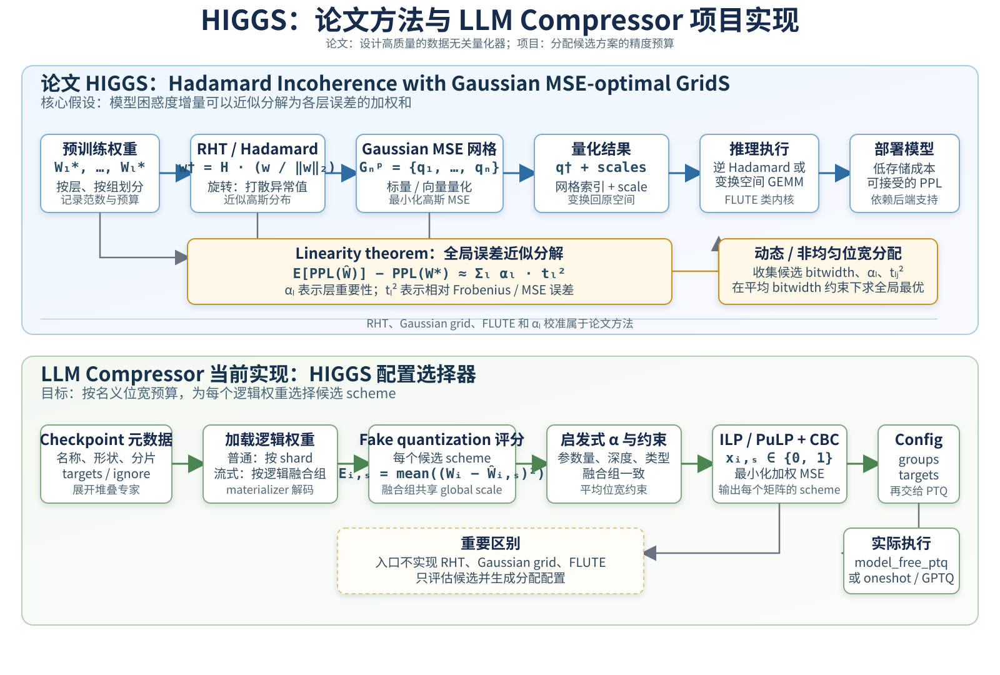
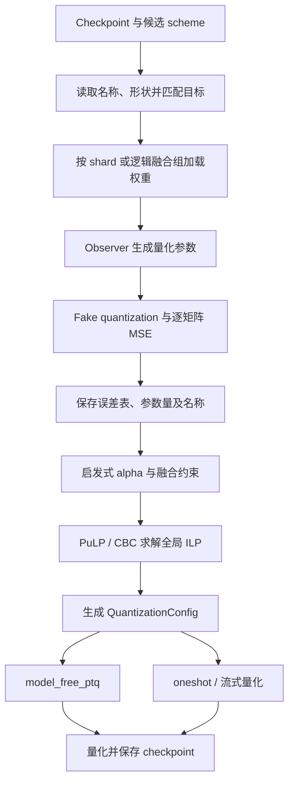

# HIGGS 混合精度量化：原理、实现与使用边界

> 本文依据 2026-11-15 的项目工作树整理，HEAD 为 `c174ca911`，并以当前源码为准。适合希望理解混合精度量化、使用项目接口，或继续改进这一功能的读者。文中的数值算例用于解释算法，不是模型精度或性能实测结果。

论文中的 HIGGS 通常展开为 **Hadamard Incoherence with Gaussian MSE-optimal GridS**；项目内部 README 使用 **Heuristic ILP-Guided Grouped Scheme** 描述当前配置选择器。为了避免混淆，本文会在上下文中明确指出“论文 HIGGS”或“项目 HIGGS”。

项目中的 HIGGS 是一个**量化方案分配器**：它先估计每个权重矩阵在不同候选方案下的失真，再在平均位宽预算和融合约束内，为各矩阵选择方案，最后输出普通的 `QuantizationConfig`。

它回答的问题是：“有限的高精度预算应该分给哪些权重？”实际量化和保存仍由 `model_free_ptq`、`oneshot` 或流式量化流程执行。理解这两阶段的分工，是正确使用 HIGGS 的起点。

本文先解释论文中的 HIGGS 量化方法，再解释仓库中同名的配置选择器。二者有共同的“以层级误差指导资源分配”思想，但不是同一个实现。



*图 1：论文 HIGGS 的量化流程，以及 LLM Compressor 当前 HIGGS 入口与它的对应关系。上半部分是论文方法，下半部分是仓库实现。*

[单独打开 SVG 查看大图](../assets/higgs-paper-flow.svg)

## 1. 为什么需要自动分配精度

### 1.1 统一位宽容易浪费预算

量化通过更少的比特表示权重。例如，相同数量的权重，仅计算数值载荷时，4 bit 存储占用是 8 bit 的一半。但降低位宽通常会增大重建误差，而且不同矩阵的误差增长并不相同。

可以把整个模型的精度预算看成一笔资金：某些矩阵从 4 bit 升到 8 bit，只能减少很少的误差；另一些矩阵却能明显改善。统一使用 8 bit 可能在前一类矩阵上浪费空间，统一使用 4 bit 又可能损伤后一类矩阵。

混合精度允许不同矩阵采用不同方案，但手工选择会遇到三个问题：

1. 大模型包含大量矩阵，MoE 还会把每层扩展为许多专家，逐个配置成本很高。
2. 不同矩阵大小不同，给一个大矩阵增加位宽，可能消耗多个小矩阵的预算。
3. 推理端可能把 Q/K/V、gate/up 等投影打包在一起，方案不能完全独立选择。

HIGGS 用统一的误差表和整数规划，把这三类决策一起处理。

### 1.2 这里的“层”具体指什么

在 HIGGS 的评分表中，一层通常是一个**二维权重矩阵对应的模块**，例如：

```text
model.layers.12.self_attn.q_proj
model.layers.12.mlp.gate_proj
model.layers.12.mlp.experts.3.down_proj
```

它不一定是一个完整 Transformer block。ILP 先为这些矩阵建立变量，再通过约束把需要一起部署的矩阵关联起来。

“候选方案”也不只是一个位宽数字。一个 `QuantizationScheme` 还可以包含整数或浮点类型、量化粒度、分组大小、observer、激活量化方式及存储格式。即使都叫 W4A16，不同方案的误差与部署条件也可能不同。

## 2. 项目 HIGGS 与论文的关系

项目 README 引用了 *Pushing the Limits of Large Language Model Quantization via the Linearity Theorem*，即 arXiv:2411.17525。论文讨论了模型退化与逐层权重扰动之间的近似线性关系，并提出结合 Hadamard 旋转与 MSE 最优网格的 HIGGS 量化方法。[R1]

当前项目模块将 HIGGS 展开为 **Heuristic ILP-Guided Grouped Scheme**。阅读代码时，需要把“借鉴的误差分配思想”与“实际实现的量化器”区分开来：

| 关注点 | 当前项目代码的做法 |
|---|---|
| 候选量化器 | 复用 compressed-tensors 的预设或自定义 scheme |
| 误差指标 | 原权重与 fake quantization 结果之间的绝对 MSE |
| 层重要性 | 由参数量、深度和名称类型计算启发式系数 |
| 分配方式 | PuLP 建模，CBC 求解整数线性规划 |
| 旋转、网格与专用内核 | 此配置选择模块不实现论文中的 Hadamard 量化及其专用推理路径 |

论文摘要描述的非均匀位宽分配归约为动态规划；本项目使用带融合约束的 ILP，也并非同一套求解实现。[R1]

因此，本文所说的 HIGGS，均指**本仓库中的配置选择功能**。论文对特定扰动条件的分析，不能直接成为任意候选 scheme、任意模型上的精度保证；项目也没有通过校准集拟合各矩阵的真实端到端敏感度。

论文方法中的主线可以概括为：

1. 对每层权重分组，并用随机 Hadamard 变换（Randomized Hadamard Transform，RHT）降低权重分布中的异常值影响，使旋转后的值近似高斯分布。
2. 用针对高斯分布优化的 MSE 网格做标量或向量量化，记录网格索引和分组 scale。
3. 使用线性定理，把模型困惑度增量近似写成各层相对平方误差 \(t_l^2\) 与层系数 \(\alpha_l\) 的加权和。
4. 当不同层可以选择不同位宽时，收集每个层—位宽候选的误差和存储开销，在平均位宽约束下进行全局优化。

论文中的 \(\alpha_l\) 是与压缩方法无关的层级缩放系数，可以通过高斯噪声注入和模型评估进行估计；仓库实现里的 `compute_heuristic_alphas()` 则根据参数量、深度和模块名称生成启发式系数。二者都叫 alpha，但含义和获取方式不同。

论文还讨论了变换空间中的推理和 FLUTE 类查表矩阵乘法内核；这些属于论文量化格式与运行时优化，当前仓库 HIGGS 配置入口没有实现。

## 3. 术语表：先理解这些词

下面的术语在源码、论文和量化实践中反复出现。理解它们，可以避免把“量化方案选择”“实际量化”和“推理执行”混为一谈。

| 术语 | 英文全称 | 含义 |
|---|---|---|
| PTQ | Post-Training Quantization | 训练完成后压缩模型权重或激活，不再更新原始训练参数。`model_free_ptq` 是项目中的无模型定义 PTQ 入口。 |
| 数据无关量化 | Data-free quantization | 不依赖真实校准数据来确定量化参数或搜索方案。论文 HIGGS 通过权重旋转和高斯网格实现这一方向；当前项目的方案评分也主要只读取权重。 |
| MSE | Mean Squared Error，均方误差 | \(\operatorname{mean}((W-\widehat W)^2)\)。它衡量原权重和量化后还原权重的平均平方差，数值越小表示重建误差越小。 |
| L2 / Frobenius 范数 | \(L_2\) norm / Frobenius norm | 向量的平方和开根号，或矩阵所有元素平方和开根号。矩阵的 Frobenius 范数等于把矩阵摊平成向量后的 L2 范数。 |
| RHT | Randomized Hadamard Transform | 随机符号与 Hadamard 矩阵组合形成的快速正交变换。它重新混合权重坐标，目标是让权重分布更接近高斯、降低异常值集中。 |
| 非相干化 | Incoherence processing | 通过旋转或其他预处理，把集中在少数坐标上的能量分散到更多坐标，减少少量 outlier 对低比特量化的破坏。 |
| 高斯 MSE 最优网格 | Gaussian MSE-optimal grid | 假设旋转后的值近似来自高斯分布，选择一组标量或向量代表值，使量化后的平均平方误差最小。 |
| 向量量化 | Vector Quantization，VQ | 一次将多个相邻数值作为一个向量，与网格中的向量代表值匹配；\(p=1\) 时可退化为标量量化。 |
| scale | 缩放因子 | 将原始权重映射到量化网格范围的数值。项目中的 scale 可能按 tensor、channel、group 或融合组共享。 |
| fake quantization | 伪量化 | 在浮点张量上模拟量化、舍入和反量化，得到 \(\widehat W\)，但不立即保存成真正的低比特存储格式。HIGGS 用它测候选 MSE。 |
| observer | 观测器 | 负责从权重或激活统计中估计 scale、zero point、global scale 等量化参数的组件。 |
| ILP | Integer Linear Programming，整数线性规划 | 目标函数和约束都是线性的，但部分决策变量必须取整数。项目中用二进制变量 \(x_{i,s}\) 表示“矩阵 \(i\) 是否选择方案 \(s\)”。 |
| PuLP / CBC | Python 建模库 / 求解器 | PuLP 将目标和约束翻译成优化问题；CBC 是实际搜索整数解的开源求解器。它们不是量化器，而是精度分配的计算工具。 |
| LP | Linear Programming，线性规划 | 决策变量可以取连续值的线性优化问题。ILP 是它的离散版本；当前项目因为方案选择和融合约束使用二进制变量，所以使用 ILP。 |
| DP | Dynamic Programming，动态规划 | 将大问题拆成有重叠子问题并复用子问题结果。论文把非均匀位宽选择描述为 knapsack 风格的动态规划问题；这与仓库中的 PuLP/CBC ILP 实现是不同求解路径。 |
| calibration | 校准 | 用一小批代表性输入运行模型，收集激活范围、二阶统计或 Hessian 等信息，以便选择或优化量化参数。GPTQ、静态激活量化通常需要校准。 |
| 融合组 | Fused group | 推理后端会一起打包或共享量化统计量的一组投影，例如 Q/K/V 或 gate/up。项目要求融合组通常选择相同 scheme。 |
| global scale | 全局缩放因子 | 融合组或 tensor group 共享的 scale。组内某个矩阵的幅值可能改变其他成员的量化误差。 |
| mixed precision | 混合精度 | 不同权重矩阵选择不同位宽或量化格式，例如部分矩阵 W4A16、部分矩阵 W8A16。 |
| average bitwidth | 平均位宽 | 按参与优化的参数量加权计算的名义平均 bits per parameter，不等于最终文件大小、显存峰值或实际吞吐。 |

可以把这些概念串起来理解为：`observer` 估计量化参数，`fake quantization` 生成候选误差，`MSE` 评价候选，`ILP` 选择候选，最后由 PTQ 或 `oneshot` 真正执行。

## 4. 从权重误差到优化问题

### 4.1 第一步：生成每个矩阵的误差表

设第 \(i\) 个权重矩阵为 \(W_i\)，包含 \(N_i\) 个元素，候选方案集合为 \(\mathcal S\)。使用方案 \(s\) 量化并还原后的权重记为 \(\widehat W_{i,s}\)，当前实现的评分是：

$$
E_{i,s}
=\frac{1}{N_i}\left\|W_i-\widehat W_{i,s}\right\|_F^2
$$

这里的 fake quantization 会模拟数值舍入、截断和反量化，得到可与原权重比较的浮点张量。它用于评估数值失真，不代表已经生成最终打包文件。

例如，一张误差表可能是：

| 矩阵 | W4A16 的 MSE | W8A16 的 MSE |
|---|---:|---:|
| A | 0.100 | 0.010 |
| B | 0.020 | 0.015 |

A 升到 8 bit 能减少 0.090 的误差，B 只能减少 0.005。如果两者大小和重要性相同，优先升级 A 更合算。

这张表测量的是**权重重建误差**。虽然候选中可以包含激活量化，当前收集过程只观察权重，不运行模型前向，也不测量激活量化误差。

### 4.2 第二步：给不同矩阵乘上重要性系数

仅把所有矩阵的 MSE 相加，相当于认为它们同等重要。项目通过以下启发式修正：

$$
\alpha_i
=\log(N_i+1)\left(1+0.05d_i\right)t_i
$$

其中：

- \(d_i\) 从名称中的 `layers.<数字>.`、`layer.<数字>.`、`h.<数字>.` 或 `blocks.<数字>.` 提取；没有匹配时取 0。
- \(t_i\) 由模块名称决定：attention 为 1.2，embedding 为 1.5，MLP 为 0.9，其他为 1.0。
- 名称同时命中多个类别时，按 attention、embedding、MLP 的顺序取第一个；参数量为 0 时，系数直接设为 1.0。

这个公式表达了“大矩阵、深层矩阵以及某些模块类型值得更多保护”的经验偏好。它不是 Hessian、梯度或实测任务损失，也不等于“某层实际敏感度提高了多少倍”。

还要注意，目标函数使用的是 \(\alpha_i E_{i,s}\)，并没有再乘 \(N_i\)。因此它不是所有权重元素平方误差的总和；大矩阵在目标中的大小修正是对数级，在预算中的开销则与参数量成正比。

### 4.3 第三步：用二进制变量表达方案选择

令：

$$
x_{i,s}\in\{0,1\}
$$

\(x_{i,s}=1\) 表示矩阵 \(i\) 选择方案 \(s\)。优化目标为：

$$
\min_x\sum_i\sum_{s\in\mathcal S}\alpha_i E_{i,s}x_{i,s}
$$

并满足以下约束。

**每个矩阵恰好选择一种方案：**

$$
\sum_{s\in\mathcal S}x_{i,s}=1
$$

**同一融合组中的矩阵选择同一种方案：**

$$
x_{i,s}=x_{j,s},
\qquad i,j\text{ 属于同一融合组}
$$

**可选的平均权重位宽上限：**

$$
\sum_i\sum_s
\frac{N_i}{\sum_j N_j}\,b_s^W x_{i,s}
\le B_W
$$

**可选的平均输入激活位宽上限：**

$$
\sum_i\sum_s
\frac{N_i}{\sum_j N_j}\,b_s^A x_{i,s}
\le B_A
$$

\(b_s^W\) 和 \(b_s^A\) 分别来自 scheme 的权重和输入激活 `num_bits`；未配置对应量化项时，预算计算使用 16。

两种平均值都只覆盖匹配 `targets`、经过 `ignore` 筛选，并最终进入评分表的二维矩阵。激活约束同样用权重参数量加权，是成本代理指标，不是对真实激活存储量的计算。

### 4.4 一个可以手算的分配例子

继续使用 A、B 的误差表，假设两者各有 100 个参数，且 \(\alpha_A=\alpha_B=1\)，没有融合约束，平均权重位宽上限为 6。

| A 的方案 | B 的方案 | 平均位宽 | 总加权 MSE | 是否满足预算 |
|---|---|---:|---:|---|
| 4 bit | 4 bit | 4 | 0.120 | 是 |
| 8 bit | 4 bit | 6 | 0.030 | 是 |
| 4 bit | 8 bit | 6 | 0.115 | 是 |
| 8 bit | 8 bit | 8 | 0.025 | 否 |

最优解是 A 用 8 bit、B 用 4 bit。

如果 A、B 必须融合，两个混合组合都不能使用，预算下只能选择全 4 bit。这个例子说明，部署约束可能减少分配空间；最优解也不一定刚好用完预算。

如果候选只有 4 bit 和 8 bit，令 8 bit 矩阵占参与优化参数量的比例为 \(p\)，则有：

$$
\bar b_W=4(1-p)+8p=4+4p
$$

所以平均 6 bit 意味着 \(p\le 50\%\)，而不是“最多一半的矩阵使用 8 bit”。矩阵大小不同时，两种说法差别很大。

### 4.5 “最优”的准确含义

这里优化的是**给定候选、误差表、启发式系数和约束下的代理目标**。即使整数规划求解成功，也不能据此断言最终困惑度、任务准确率或推理速度最优。

两个预算都不设置时，独立矩阵只需选择自身 MSE 最低的候选；融合组则选择组内加权 MSE 总和最低的候选。对没有耦合的独立矩阵，正的 \(\alpha_i\) 不会改变其候选排序。

## 5. 源码如何把这一过程落地

### 5.1 整体数据流



这个结构把昂贵的权重计算与较小的全局决策分开：收集阶段需要访问权重，求解阶段主要使用标量摘要。

### 5.2 普通入口：按 checkpoint 分片收集

`get_higgs_config()` 的主要步骤是：

1. 将预设名称或自定义对象解析为候选 scheme，建立 `HiggsMSECollectorConverter`。
2. 读取 checkpoint 文件和完整权重索引，预先登记融合依赖。
3. 通过 inverse weight map 安排分片与跨分片依赖。
4. 先在 `meta` 设备上检查目标形状，避免加载真实数据后才发现不支持的三维权重。
5. 逐分片加载实际张量，收集每个候选的 MSE。
6. 调用 `create_config()`，求解 ILP 并生成配置。

其中，`meta` 张量只有形状、类型等信息，不保存真实权重数据。已识别的三维 MoE 堆叠权重会先拆为二维专家矩阵；普通路径会跳过匹配到的非二维向量，并拒绝无法解释的三维及更高维目标。

普通入口不需要构造完整的 Hugging Face 模型，但其加载粒度仍是分片及相关依赖。**不加载完整模型，不代表内存峰值只有一个矩阵。**

### 5.3 MSE 计算复用了真实的量化组件

`compute_layer_mse()` 实际调用 `compute_fused_layer_mse()`，后者为每个权重建立一个临时 `torch.nn.Linear`：

1. 在 `meta` 上创建 Linear，再挂上当前权重，避免初始化一份无用的随机权重。
2. 按候选 scheme 初始化量化状态和权重 observer。
3. 连接需要共享统计量的 observer，观察权重并更新 scale、zero point 等量化参数。
4. 调用 `fake_quantize()`，使用权重 scheme 及可能存在的 `global_scale` 生成重建结果。
5. 计算 `mean((weight - quantized) ** 2)`，保存为一个标量。

因此，候选中配置的 observer 会影响误差表。比如，示例将 NVFP4 权重 observer 设置为 `nvfp4_expanded_mse` 后，评分就会经过这个 observer 的参数搜索路径。

但临时 Linear 没有实际前向输入。即使 scheme 指定了 `imatrix_mse`，这一过程也不会自动收集输入重要性；当前该 observer 在缺少重要性统计且未启用严格模式时会回退。选择阶段的 observer 名称相同，不意味着它与后续有校准数据的执行阶段拥有相同统计量。

### 5.4 融合需要同时约束“选什么”和“怎么算误差”

融合映射统一定义在 `observers/fused_mappings.py`。典型组合包括 Q/K/V、gate/up，以及部分 MLA、稀疏或线性注意力投影。匹配考虑共同父模块、必需成员、可选成员和上下文成员；存在重叠时优先使用更大的匹配组。

融合有两个不同的作用：

| 层面 | 当前行为 | 原因 |
|---|---|---|
| 方案分配 | 已识别融合组总是使用同一种 scheme | 对齐推理端的权重打包方式 |
| 误差计算 | `TENSOR_GROUP` 等当前识别的 microscale scheme 联合观察融合成员 | 对齐共享 global scale 的数值行为 |

以 NVFP4 为例，一个小幅值投影与一个大幅值投影共享 global scale 时，小投影的误差可能不同于单独量化时的结果。只在 ILP 中约束二者位宽相同，而分别计算其 scale，仍然可能得到不准确的误差表。

普通入口通过完整权重索引补齐跨分片的 microscale 融合依赖。直接使用 collector 时，如果需要调用其依赖解析逻辑，应先执行 `set_weight_names()`；手动调用 `process()` 时，也应提供完整的相关融合组。

融合规则只描述代码已知的组合。它们不负责判断某个特殊投影在目标后端上是否允许量化；这仍需要模型特化的 `targets`、`ignore` 和部署验证。

### 5.5 ILP 求解与配置输出

`solve_ilp_mixed_precision()` 用 PuLP 建立二进制变量，再通过 CBC 求解。当前超时设置为 300 秒，代码接受 PuLP 报告为 `Optimal` 的结果；其他状态会报错，没有单独实现“返回超时可行解”的策略。

位宽约束先把参数量归一化为比例，避免直接使用大模型的巨大参数计数作为系数。若有 \(L\) 个矩阵、\(S\) 个候选，基础二进制变量数约为 \(LS\)，融合关系还会增加等式约束。

求解后，`generate_config_groups()` 把选择相同 scheme 的矩阵归到一个配置组，复制候选配置并替换 `targets`。普通模块使用带起止锚点、经过转义的正则表达式；MoE 专家只有在通配后不会覆盖其他已分配方案的专家时，才折叠为专家编号通配模式。

这意味着 `len(scheme.targets)` 是匹配表达式数量，不能直接当成所选矩阵数量。最终格式由方案指定或推断，顶层配置状态设为 `COMPRESSED`；该状态是输出配置的元数据，**此时原 checkpoint 尚未被量化或改写**。

## 6. 大模型的流式路径

### 6.1 将加载粒度缩小到当前逻辑组

`StreamingHiggsConfigProvider` 复用相同的 MSE collector 和 ILP，主要改变权重如何进入评分过程：

1. 从 `CheckpointWeightSource` 读取名称、形状与 dtype。
2. 根据元数据将已知的堆叠专家布局展开为逻辑二维权重名称。
3. 用元数据张量匹配目标，再划分融合组或单矩阵组。
4. 为当前组请求物理权重及 materializer 声明的解码依赖。
5. 在 CPU 上 materialize 为计算张量，取出对应逻辑矩阵，再交给 collector。
6. 释放当前组的数据引用，只保留 MSE、参数量等摘要；收集完成后统一求解。

`WeightSource` 负责“从哪里读取”，`WeightMaterializer` 负责“怎样把存储内容解释为计算权重”。普通浮点 checkpoint 默认使用 `CastWeightMaterializer`；特殊打包、重命名或编码布局应由对应 materializer 解释。

流式路径默认将计算权重转换为 BF16。若要与保留 FP32 权重的普通路径比较，应显式统一 `target_dtype`、设备、observer 和候选配置。

### 6.2 内存边界应该怎样理解

对于普通二维权重，峰值主要来自当前物理组、解码副本、设备上的计算权重，以及 fake quantization、差值和平方等临时张量；全局误差摘要约为 \(O(LS)\)，另外还有名称、索引和 ILP 的内存开销。

但当前堆叠 MoE 路径存在一个容易误解的细节：**它先读取并 materialize 整个物理三维张量，再选取某个专家的二维切片。**

例如，一个 `[专家数, 2 × 中间维度, 隐藏维度]` 的 `gate_up_proj`，在元数据层面能展开为多个逻辑投影，但 source 的读取接口仍按完整物理 tensor 工作；默认 materializer 还会复制完整张量。同一物理 tensor 可能在处理不同逻辑组时被多次请求和转换。

因此，这条路径减少的是跨模型的持续权重驻留；对堆叠专家，不能承诺“只需单个专家大小的 CPU 内存”，也不能承诺整个搜索只读取每个物理 tensor 一次。更严格的切片读取与增量解码仍是可改进方向。

### 6.3 流式选择与流式量化仍然分为两阶段

流式 provider 输出普通 `QuantizationConfig`，没有成为主 pipeline 中自动运行的 modifier stage。后续执行过程通常还需要再次读取权重：

```text
流式读取并评分 → 全局选择配置 → 量化流程重新读取并应用配置
```

provider 提供 `config_fingerprint` 标识其配置输入，但这不是自动的 MSE 磁盘缓存或断点续跑。该指纹本身也不包含 checkpoint 内容校验，不能单独作为跨模型复用评分结果的充分依据。

在 DeepSeek V4.1 示例中，HIGGS 可与 GPTQ 组合；Engram `wkv` 则可以先排除在搜索之外，再合并固定的 W8A8 配置。此时 HIGGS 的位宽预算只约束搜索覆盖的普通矩阵，额外合并的固定组需要另行计入最终资源预算。

## 7. 怎样使用并检查结果

### 7.1 安装与候选选择

在已满足项目基础依赖的环境中，安装 HIGGS 可选依赖：

```bash
pip install -e ".[higgs]"
```

ILP 依赖 PuLP 和可用的 CBC 可执行文件。当前实现优先复用 PuLP 提供的 CBC 路径；实际环境是否包含可执行文件，仍需检查。候选预设的具体定义则来自当前安装的 compressed-tensors。

选择候选时，应同时确认量化数值格式、执行阶段所需校准、存储格式以及目标推理后端的支持情况。常见组合是：

| 候选组合 | 主要用途 | 应用配置时的注意点 |
|---|---|---|
| `W4A16` + `W8A16` | 比较不同整数权重位宽 | 核对分组大小与后端支持 |
| `NVFP4A16` + `FP8_DYNAMIC` | 混合低比特浮点权重与动态 FP8 激活路径 | 激活处理方式也随方案变化 |
| `NVFP4`、`FP8` 等静态激活方案 | 在静态激活格式之间选择 | 后续必须收集激活校准数据 |

所有候选都应包含受支持的权重量化配置。当前这条路径围绕权重评分设计，不是纯激活量化方案的通用搜索器。

### 7.2 先选择，再执行无数据量化

下面示例假设本地存在普通浮点 safetensors checkpoint，并有可用的 CUDA 环境；模型和最终方案仍需满足目标后端要求。

```python
from llmcompressor import model_free_ptq
from llmcompressor.entrypoints.higgs import get_higgs_config

config, collector = get_higgs_config(
    model_stub="./model",
    candidate_schemes=["W4A16", "W8A16"],
    targets="Linear",
    ignore=["lm_head", "re:.*embed_tokens"],
    target_avg_bitwidth=6.0,
    allow_unquantized=False,
    device="cuda:0",
    return_collector=True,
)

print("参与优化的矩阵数：", len(collector.layer_sizes))
print("输出配置组数：", len(config.config_groups))

model_free_ptq(
    model_stub="./model",
    save_directory="./model-higgs",
    config=config,
    device="cuda:0",
)
```

`return_collector=True` 实际返回 `(config, collector)`，可用来检查评分和分配；默认只返回配置。`model_free_ptq` 会拒绝需要静态激活校准的方案。

如果要更接近项目提供的浮点混合示例，可以参考 [NVFP4A16 + FP8_DYNAMIC 示例](../../examples/quantization_higgs/higgs_nvfp4a16_fp8_model_free.py)，其中额外配置了 NVFP4 的 `nvfp4_expanded_mse` observer。

### 7.3 需要 GPTQ 或静态激活校准时

HIGGS 输出的配置组可以交给 modifier：

```python
from llmcompressor import oneshot
from llmcompressor.modifiers.gptq import GPTQModifier

recipe = GPTQModifier(
    config_groups=config.config_groups,
    ignore=config.ignore,
)

oneshot(
    model="./model",
    recipe=recipe,
    dataset="perfectblend",
    splits="train[:256]",
    num_calibration_samples=256,
    max_seq_length=2048,
    output_dir="./model-higgs-gptq",
)
```

这里的 `config` 来自前面的方案选择。完整流程也可参考 [oneshot 示例](../../examples/quantization_higgs/higgs_w4a16_fp8_oneshot.py)，其中可以在 `QuantizationModifier` 和 `GPTQModifier` 之间选择。

HIGGS 负责分配方案；GPTQ 则利用校准激活构造二阶信息，改善既定方案下的权重量化结果。两者可以组合，但当前 HIGGS 预先记录的 MSE 并不是 GPTQ 优化后的实际误差。

### 7.4 需要控制权重驻留时

对于普通浮点 checkpoint：

```python
import torch
from llmcompressor.entrypoints.higgs import get_higgs_config_streaming

config = get_higgs_config_streaming(
    "./model",
    candidate_schemes=["W4A16", "W8A16"],
    targets="Linear",
    ignore=["lm_head", "re:.*embed_tokens"],
    target_avg_bitwidth=6.0,
    device="cuda:0",
    target_dtype=torch.bfloat16,
)
```

若需要检查流式收集的摘要，可以显式建立 provider：

```python
from llmcompressor.streaming.higgs import StreamingHiggsConfigProvider

provider = StreamingHiggsConfigProvider(
    ["W4A16", "W8A16"],
    target_avg_bitwidth=6.0,
    device="cuda:0",
)
collector = provider.collect("./model")
config = collector.create_config()
```

特殊 checkpoint 还需要传入相应的 `materializer`。这不是简单地将 `model_stub` 换成目录就能自动兼容所有量化存储格式；默认 materializer 仅接受 FP32、FP16、BF16 源张量。

### 7.5 平均位宽应从真实分配重算

不要仅凭“几个配置组”或“几个正则表达式”估计平均精度。对普通入口返回的 collector，可以这样重算：

```python
from llmcompressor.entrypoints.higgs.utils import UNQUANTIZED_SCHEME

scheme_bits = {
    name: float(scheme.weights.num_bits)
    for name, scheme in collector.candidate_schemes.items()
}
scheme_bits[UNQUANTIZED_SCHEME] = 16.0

total_params = sum(collector.layer_sizes.values())
selected_bits = sum(
    collector.layer_sizes[layer_name] * scheme_bits[scheme_name]
    for layer_name, scheme_name in collector.ilp_solution.items()
)
average_bits = selected_bits / total_params
print("参与优化权重的平均位宽：", average_bits)
```

这重现的是优化器的**名义权重位宽口径**。要估算文件大小，还需要加上忽略权重、量化元数据、对齐填充等；要估算推理显存，还需要单独考虑激活、KV cache、工作区和后端副本。

### 7.6 允许部分矩阵保留原精度

`allow_unquantized=True` 会加入一个内部候选 `__unquantized__`：

| 项目 | 当前处理 |
|---|---|
| 权重 MSE | 设为 0 |
| 权重与输入激活预算 | 均按 16 bit 计费 |
| 输出配置 | 被选中的矩阵不进入量化配置组 |
| 实际执行 | 保留原 dtype |

因此，原权重为 FP32 时，“保留原精度”的实际权重开销是 32 bit，而预算仍按 16 bit 计算。两个位宽预算都不设置时，保留原精度是零误差最优解之一，通常会使大量甚至全部矩阵不量化。

## 8. 方法本身的局限

### 8.1 权重误差不能完整代表模型误差

为什么相同权重 MSE 可能带来不同效果？对一个列向量输入的 Linear，记：

$$
y=Wx,\qquad
\Delta W=\widehat W-W
$$

则输出扰动为 \(\Delta y=\Delta W x\)。在输入具有有限二阶矩时：

$$
\mathbb E\|\Delta y\|_2^2
=\operatorname{tr}
\left(\Delta W\,\mathbb E[xx^\top]\,\Delta W^\top\right)
$$

只有在输入二阶矩近似为 \(cI\) 等条件下，这个量才与 \(\|\Delta W\|_F^2\) 成正比。当前评分没有使用 \(\mathbb E[xx^\top]\)，因此忽略了输入通道的尺度与相关性。

这还只是单个线性层。完整模型包含激活函数、归一化、残差、attention softmax 和 MoE 路由；不同层的扰动也可能相互作用。低比特下的明显退化，更不能由小扰动近似自动排除。

工程上应把权重 MSE 用于低成本筛选，再通过校准集上的输出误差、困惑度或任务指标检验最终方案。涉及 attention 误差的进一步分析，可参考 [iMatrix 与 Attention 误差评价笔记](../reports/imatrix-mse-attention-error-metrics-2026-10-21.md)。

### 8.2 当前没有给激活量化造成的退化打分

若两个候选的权重量化部分相同，仅输入激活配置不同，当前评分流程没有观测数据来衡量二者的激活误差差异；分配可能主要受激活位宽约束或求解器的并列选择影响。

因此，比较 W4A16 与某种 W8A8 时，“8 bit 权重 MSE 更小”不能独立证明整个 W8A8 路径更准确。静态校准与动态量化的效果，都需要执行阶段的数据验证。

### 8.3 启发式重要性容易受到架构与命名影响

`\alpha_i` 不包含专家使用频率、token 分布、残差放大程度或真实任务损失。更换命名方式还可能改变类别匹配或深度识别，进而改变分配。

绝对 MSE 也会受权重本身的尺度影响：某个矩阵数值较大，并不必然说明相同相对误差对任务更危险。改用相对误差也不会自动解决敏感度问题，应结合输出误差或敏感度实验判断。

尤其在 MoE 中，存储开销与所有专家参数量相关，但计算负载与实际路由分布相关。当前参数量预算适合表达部分存储约束，无法表达专家访问热度和延迟收益。

### 8.4 位宽预算是资源代理

实际权重存储可以粗略分解为：

$$
\text{总字节}
\approx
\text{权重数值载荷}
+\text{scale / zero point}
+\text{保留权重}
+\text{填充与其他元数据}
$$

相同名义位宽的不同分组方案，scale 数量可能不同。当前权重预算没有计算这些额外成本，也没有覆盖被 `ignore` 排除的矩阵。

激活预算的偏差更直接：对一个 `[out_features, in_features]` 的权重，参数量是二者的乘积，但输入激活大小还取决于 token 数和 `in_features`，峰值则取决于生命周期与调度。用参数量作为激活权重，不能约束真实激活峰值或 KV cache。

### 8.5 更少的比特不自动带来更低的延迟

HIGGS 不测量内核吞吐、解包与反量化成本、矩阵尺寸利用率、不同 scheme 切换开销或设备架构差异。混合格式可能降低存储，却未必提升特定后端上的吞吐。

同样，`QuantizationConfig` 能成功生成，只说明配置选择过程完成；还应验证目标运行时是否支持具体 scheme、分组、融合方式和专家布局。

### 8.6 选择阶段与执行阶段可能存在差异

以下因素都可能改变最终数值结果：

- 选择阶段以 BF16 权重评分，执行阶段从其他 dtype 开始量化。
- observer 在选择阶段没有输入统计，在执行阶段获得了校准统计。
- 选择阶段使用直接 fake quantization，执行阶段使用 GPTQ 进行权重补偿。
- 目标后端使用不同精度的 scale、实际打包或融合实现。

保持两个阶段的候选参数、dtype 和融合规则一致，可以减少偏差；最终仍应测量保存后、重新加载的模型。

## 9. 当前实现中需要留意的具体问题

以下问题依据当前工作树整理。它们与前面的建模局限不同，属于可定位的实现边界或缺陷；本文记录这些问题，没有修改量化代码。

### 9.1 同位宽的自定义候选可能被覆盖

位置：`HiggsMSECollectorConverter._resolve_schemes()`。

预设字符串直接作为候选字典的 key；自定义 `QuantizationScheme` 则主要按 `W<位宽>A<位宽>` 命名。两个自定义对象即使分组大小、observer、数值类型或 scale dtype 不同，只要位宽相同，就会得到同一个 key，后者覆盖前者。

例如，两个 W4A16 候选分别使用 group size 64 和 128，当前解析结果只会留下一个。搜索前应检查 `collector.candidate_schemes` 的实际内容；要在同一轮比较此类候选，需要先完善唯一命名或显式命名接口。

### 9.2 计算失败的候选没有被硬性禁用

位置：`compute_fused_layer_mse()` 与 `solve_ilp_mixed_precision()`。

MSE 计算捕获异常后返回 `inf`，但求解器会把误差裁剪到 `[0, 1e10]`。这将“无效候选”变成了一个成本极高、但仍允许选择的候选。

通常它会被正常候选击败；但如果预算只能通过该候选满足，或者某组的所有候选都失败，ILP 仍可能选择它。融合约束也可能使影响扩展到同组成员。

更可靠的实现应显式令无效候选的 \(x_{i,s}=0\)，并在某矩阵没有可用候选时尽早报错。当前使用时，应检查 warning、误差表中的非有限值，以及最终是否选中了失败方案，不能把“求解成功”作为候选有效性的证明。

### 9.3 流式 `w13` 拆分存在已复现的切片错误

位置：`StreamingHiggsConfigProvider._slice_logical_weight()`。

元数据展开会把 `w13` 识别为 `w1` 和 `w3`，但取前半段的条件只判断名称是否为 `gate_proj`。因此，在当前代码中，`w1` 和 `w3` 都会走“后半段”分支。

用形状 `[1, 4, 2]`、元素依次为 0 到 7 的张量直接执行源码中的展开与切片方法，可得到：

| 逻辑投影 | 应取的行 | 当前结果 |
|---|---|---|
| `w1` | `[[0, 1], [2, 3]]` | `[[4, 5], [6, 7]]` |
| `w3` | `[[4, 5], [6, 7]]` | `[[4, 5], [6, 7]]` |

这是权重视图构造错误，会污染对应投影的 MSE，不能归因于量化算法本身。已声明支持的该布局应先修正切片并补充数值测试，再用于精度分配。

### 9.4 流式堆叠专家支持仍有性能和覆盖边界

流式元数据展开仅识别代码列出的布局名称，不是任意三维 tensor 的通用解释器。普通路径的 `split_fused_moe_experts()` 与流式展开支持的名称也并不完全相同。

此外，当前物理 tensor 的整块 materialize 和重复读取，会使 CPU 内存、拷贝及 I/O 成本明显大于逻辑单专家大小。现有流式测试检查了请求名称、分组和逻辑权重覆盖，没有测量大规模真实峰值，也没有证明只读取专家切片。

### 9.5 其他接口边界

| 边界 | 当前行为及影响 |
|---|---|
| 空的 `ignore` 列表 | collector 使用 `ignore or ["lm_head"]`，因此传 `[]` 仍会启用默认忽略项 |
| 目标匹配 | checkpoint 路径不能依赖真实模块类型；`Linear` 的名称匹配可能包含需要额外排除的权重 |
| 非矩阵目标 | 普通路径跳过一维向量；流式路径会在实际切片时拒绝非二维物理目标，不能假定二者完全等价 |
| dtype 与数值计算 | MSE 没有显式将差值、平方和均值统一提升到 FP32，结果受实际张量 dtype 影响 |
| 求解时间 | 300 秒为固定上限，入口没有暴露求解时限、gap 或备用求解器选项 |
| 中间结果复用 | 当前没有 provider 自动提供的 MSE 持久化、恢复或多预算批量搜索接口 |

这些边界说明，接入新模型时，应该先检查逻辑权重映射、匹配范围和候选集合，再运行大规模搜索。

## 10. 如何验证与继续改进

### 10.1 一次完整实验应回答哪些问题

建议按以下顺序组织实验，使每一步都能解释下一步的结果：

1. **检查覆盖范围。** 导出实际矩阵名称、形状和参数量，确认 embedding、router、特殊投影及专用编码权重是否被正确处理。
2. **检查评分有效性。** 核对解析后的候选个数、无效候选、observer 回退和共享 scale；用小矩阵检验专家切片与融合行为。
3. **检查约束。** 从原始分配重算参数量加权位宽，验证融合组的一致性，以及不同配置组的匹配是否重叠。
4. **检查实际量化。** 用与评分一致的方案执行，保存后重新加载，确认格式、scale dtype 和运行时加载均符合预期。
5. **检查模型质量。** 与同条件的统一低精度、统一高精度和合理手工混合方案比较；使用独立评估数据测量困惑度或任务指标。
6. **检查部署收益。** 统计真实文件大小、峰值内存、prefill/decode 延迟和吞吐，记录具体硬件与后端。

本仓库现有测试主要覆盖 ILP 分配、预算、融合一致性、未量化候选、MSE 收集、部分形状处理及专家目标正则。流式 HIGGS 测试还覆盖按组请求与常见 `gate_up_proj`/`down_proj` 的逻辑展开。

相关测试命令为：

```bash
pytest tests/llmcompressor/entrypoints/higgs tests/llmcompressor/streaming/test_higgs.py -v
```

普通 HIGGS 测试中的求解器相关用例会在缺少 PuLP/CBC 时跳过。测试通过能支持所覆盖的接口行为，不能替代真实大模型、真实峰值内存和部署性能实验。

### 10.2 改进应分清正确性、评分质量和性能

| 优先方向 | 可行改进 | 需要验证的效果 |
|---|---|---|
| 配置正确性 | 候选使用完整配置指纹或显式唯一名称；硬性禁用失败候选 | 不丢候选，不输出不可用选择 |
| 布局正确性 | 修正 `w13` 切片；统一普通与流式逻辑权重映射；测试切片值 | 评分对象与真实权重一致 |
| 资源准确性 | 按实际 dtype、scale、zero point、填充和保留权重计算字节 | 预算与真实产物大小接近 |
| 敏感度质量 | 可选采集输入二阶矩、模块输出误差，或通过小规模扰动实验估计层系数 | 代理分数与任务退化更相关 |
| 激活评价 | 对候选的激活量化进行校准并测量输出误差 | 能区分权重相同、激活不同的方案 |
| 执行一致性 | 对 GPTQ 等执行方法采样建立更贴近最终结果的评分 | 减少选型阶段与执行阶段的排序偏差 |
| 大模型效率 | tensor 切片读取、增量解码、MSE 缓存及断点恢复 | 降低物理 tensor 驻留和重复 I/O |
| 部署目标 | 引入实测的后端兼容表、延迟或吞吐成本 | 分配直接服务于目标设备 |

这些是后续设计方向，当前接口并未全部实现。其中更丰富的敏感度指标通常需要额外校准数据和前向计算，需要在搜索成本与决策质量之间取舍。

对现有功能最合适的定位是：**以较低的模型执行成本，自动生成满足名义位宽预算与已知融合规则的混合精度候选配置，再通过真实量化和部署评估完成筛选。**

## 11. 源码、示例与参考资料

| 内容 | 入口 |
|---|---|
| 普通收集器、方案解析与高层入口 | [entrypoints/higgs/base.py](../../src/llmcompressor/entrypoints/higgs/base.py) |
| 误差计算、重要性系数与配置生成 | [entrypoints/higgs/utils.py](../../src/llmcompressor/entrypoints/higgs/utils.py) |
| ILP 目标、约束及 CBC 调用 | [entrypoints/higgs/ilp_solver.py](../../src/llmcompressor/entrypoints/higgs/ilp_solver.py) |
| 流式 provider 与逻辑专家展开 | [streaming/higgs.py](../../src/llmcompressor/streaming/higgs.py) |
| 物理 checkpoint 张量读取 | [checkpoint/weight_source.py](../../src/llmcompressor/streaming/checkpoint/weight_source.py) |
| 默认浮点 materializer | [materialization/default.py](../../src/llmcompressor/streaming/materialization/default.py) |
| 融合映射及 observer 联动 | [fused_mappings.py](../../src/llmcompressor/observers/fused_mappings.py)、[fusion.py](../../src/llmcompressor/observers/fusion.py) |
| 普通路径的 MoE 拆分 | [model_free/converter.py](../../src/llmcompressor/entrypoints/model_free/converter.py) |
| 无数据执行路径的方案校验 | [model_free/validate.py](../../src/llmcompressor/entrypoints/model_free/validate.py) |
| ILP 单元测试 | [test_ilp_solver.py](../../tests/llmcompressor/entrypoints/higgs/test_ilp_solver.py) |
| 收集器与配置测试 | [test_integration.py](../../tests/llmcompressor/entrypoints/higgs/test_integration.py) |
| 流式收集测试 | [test_higgs.py](../../tests/llmcompressor/streaming/test_higgs.py) |
| 普通量化示例 | [examples/quantization_higgs](../../examples/quantization_higgs) |
| 模型特化组合示例 | [deepseek_v41_wNa8.py](../../examples/streaming_oneshot/deepseek_v41_wNa8.py) |

**[R1]** Vladimir Malinovskii 等，*Pushing the Limits of Large Language Model Quantization via the Linearity Theorem*，2024，arXiv:2411.17525。本文核对了该论文 v1 的摘要，用于说明研究背景及方法边界；本项目的 API、公式、加载行为和缺陷判断均以所列源码为依据。
